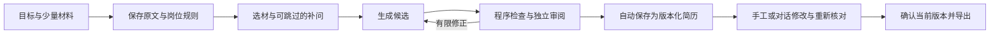

# Match-Trajectory

帮助互联网求职者用少量材料，生成、对话修改并交付简历的开源 AI 工作台。当前开发版采用集中编排的多 Agent 流程、版本化编辑、事实门禁和 A4 同源导出；保留人工核对、删除和历史版本。

## 开始使用

1. 双击根目录 `Start-App.cmd`，浏览器打开本机工作台。Linux / macOS 可在构建前端后运行 `python -m app.cli --no-browser`，再打开终端里打印的本机地址。
2. 点击左下角“模型连接”：可选 OpenAI／ChatGPT、Anthropic／Claude、DeepSeek、阿里云百炼，或填写 OpenAI 兼容中转站的 Base URL、模型 ID 与 Key。连接测试会区分 Key 无效、余额不足、限流、网络和超时，不回显 Key。勾选“记住 Key”只会尝试写入本机系统钥匙串；否则 Key 仅留在本次服务内存。
3. 中间先明确简历方向，再上传旧简历或 JD（PDF、Word 的 .docx / .doc、TXT、Markdown；最大 8 MB，PDF 最多 12 页）。产品、后端、前端、测试、数据开发、算法／Agent、数据分析和运营会加载各自规则；其他方向明确使用通用规则。材料里已有的姓名、联系方式、学校、教育时间和经历不用重填；手工输入始终优先。扫描版 PDF 会请你改为粘贴。
4. 生成仍走原来的分阶段流程。追问最多一轮、最多三个问题，回复「跳过」也会给出完整初稿。已有经历缺的细节标在那一条上；岗位差距只出现在旁边，不写进正文。
5. 选择一份已保存简历或一个已有候选的生成任务，右侧“简历 Agent”会绑定到这个具体对象。可以说“把最长的一条压缩到一行”或“更突出本人负责的部分”。通过事实校验的修改会自动保存为新版本，并显示前后差异与一键撤销；没有原文依据的内容不会写入，用户可以直接继续澄清。左侧手工编辑与右侧 Agent 修改共享同一版本历史。

新建页按“选方向 → 放材料 → 授权发送 → 生成核对”排列。生成通过后自动进入编辑器，不再要求用户额外点击“采用”。目标岗位可选填；姓名、联系方式、教育、求职背景、原文编辑和高级生成选项在“补充信息与高级选项”中。若有补问，可回答，也可跳过。编辑后可直接下载当前 PDF／Word，审阅提示不会阻止下载。

右侧 Agent 不承担上传或生成阶段的材料收集。它只操作当前已选择的简历版本或生成候选：会话保存目标类型、目标 ID 和基线版本；模型只能返回结构化候选，程序重新计算差异、核对引用和事实门禁。若用户在其他位置保存了新版本，自动保存或撤销都会因版本冲突而停止，绝不覆盖较新的编辑。

没有勾选记住 Key，或本机没有可用的系统钥匙串时，Key 只保留在本次服务内存中，重启需要重新填写。生成可能产生模型费用；失败后继续会保留已用预算。结构失败会给出安全的字段诊断，并与调用次数、耗时上限分开提示。连接测试成功只代表短文本探针通过，不代表完整生成质量得到验证。

默认生成使用分阶段图流程，无需额外模型配置。可选试用：先在“模型连接 → 可选：智能修正策略”测试工具调用（额外1次合成请求，可能计费），再在“生成选项”启用智能修正。主管只在多项可修问题需要取舍时介入，所有调用计入原8次上限；不支持工具时继续使用默认生成。更换连接或重启后需要重新测试工具能力，不按模型名称推断支持。

已有任务保持原执行器和图版本；新任务使用显式阶段图m17-v2，旧m15-v1与legacy仅走兼容适配。阶段处理器产出结果，纯策略决定允许转移，业务提交原子保存结果与下一状态；图按该转移执行，不再让新图调用旧execute_step分发器。业务库保存事实、候选、版本和预算；`data/workflow-checkpoints.sqlite3`只保存图进度与结果引用，不保存Key、原文或联系方式。图检查点不替代备份，仍不要在服务运行时直接复制数据库文件；备份恢复尚未提供完整产品入口。

姓名与联系方式单独保留在本机；教育信息作为事实材料发送，程序固定回填，不由模型改写。你主动写在材料正文中的隐私也会随正文发送。资料在项目 `data/`，不提交到 Git。

不使用模型时，填写材料后点击“进入编辑器”，仍可编辑、保存、确认和导出。也可使用明确标为虚构的示例体验。

在 PowerShell 中启动：

```powershell
cd D:\AI-VibeCoding\mx_demo\Match-Trajectory
.\scripts\Start-App.ps1
```

运行期间保留终端，按 `Ctrl+C` 停止。当前启动器兼容 Windows 自带 PowerShell；全新克隆先按下文重建环境。便携程序已在开发机验证，仍不是完成干净系统与再分发许可核验的公开发布包。

## M1.7预算与效果验证

新任务保存完整budget-v1策略快照，旧无快照任务使用固定兼容默认。执行、重试、主管、继续及UI读取同一策略；默认仍为8次请求、两轮修正、180秒，并预留最终审阅额度。次数上限不是费用上限，供应商usage未知时不伪造token或金额。

参考日期使用Asia/Shanghai；数字归一化仅限所引用材料，支持年份空格、千分位和小数等价，不允许从别的项目取数字或改变数量级/单位。

[效果对照工具说明](evaluation/README.md)：默认只准备冻结材料、规则和人工评审模板；显式--run才读取环境Key并发请求。probe/重试计入全局和每例预算，调用前持久记账，拒绝覆盖或自动恢复未知调用。本轮未进行真实供应商对照，工具和合成测试不是质量验证结果。超限选材与更大规模真实效果验证仍在后续计划。

## 人工核对与删除

点击“自行核对并接管”后，有阻断则逐项处理：原文支持时选择依据、填写说明；内容不对可返回对应字段编辑；不确定可下载草稿。保存一项后自动进入下一项，全部处理后明确确认接管，即可确认并正式导出。取消最后确认会保留已完成的核对，可稍后继续。已知事实问题仍不能一键忽略。

简历和任务列表旁有删除按钮，操作前会显示范围并要求确认。删除简历会清除正文、历史版本、关联任务和导出文件；删除已采用任务时，简历所需来源会继续保留，直到删除该简历。删除任务会取消执行并隐藏记录，少量不含个人材料的取消标记用于拒绝迟到结果；已经下载到其他目录的文件和用户自己的备份不在清理范围。文件占用等清理失败会明确提示，记录待办并在下次启动或重复删除时重试。

## 怎样生成与核对



- 新任务按显式方向加载规则：产品经理、后端、算法／Agent、数据分析、内容／用户运营；其他方向使用通用规则。岗位名称不再猜测方向。已经保存的任务继续使用当时冻结的规则版本。
- 没有 JD 时使用维护的通用画像，不把岗位要求写成个人事实。缺数字或结果时保留已有动作，不编收益。
- 教育使用固定字段；项目／工作／科研经历分别填写名称、角色和起止时间，同类经历倒序，未知日期留空。支持正文中的少量重点短语加粗，预览、PDF 和 Word 一致表达。
- 审阅分开给事实结论和写作质量：适配、个人贡献、亮点证据、易读性各给理由及依据。已有证据但表达不足时有限修正；材料缺口只提醒，不反复扩写。旧报告没有质量结果时显示未评估，修改后旧质量结论立即失效。
- Skill 按执行阶段、目标岗位和明确选择的求职背景加载，资源清单随任务冻结。先形成“目标关注点 → 原文来源 → 本人动作 → 交付／验证 → 未知项”的选材映射；审阅再把角色、范围、状态、结果口径和因果归因拆开核对。通用方法、岗位规则、经历写法和合成正反例共同指导选材与表达；不加载其他方向的案例，不将示例事实当个人事实。
- 起草优先每条一个贡献、每段2—4条；简介和长段落有压缩提醒，可触发有限修正。材料不足不为凑数扩写；缺时间和表达建议不作为事实阻断。
- 最多一轮三个问题、两轮内容修正、八次模型请求；单请求 45 秒、累计执行 180 秒，等待回答不计时。
- 任务保存在 SQLite。刷新可恢复查看；重启后未完成任务标为中断，不自动重放付费请求。继续需连接原供应商、地址和模型。
- 候选采用为新简历，原简历不覆盖。编辑使 AI 审阅失效；有未解决阻断时只可导出草稿。
- 可以选择“自行核对并接管”。有阻断时先打开逐项核对：选择支持当前表述的原文、填写说明并确认，保存后再接管。原报告保留；程序仍拒绝无依据数字、技能和责任冲突。修改正文会使人工核对失效，删除原问题条目会记录删除动作。此流程无需模型连接。

运行规则位于 [Skill 目录](skills/resume-writing/SKILL.md)，由应用按岗位和阶段加载。模型没有文件、命令或数据库执行权限。

## 当前范围

| 已实现 | 仍需完成或验证 |
| --- | --- |
| PDF／Word／文本上传、可选 JD、八类岗位规则、候选生成与审阅 | 个人资料库、原材料修订与全链路失效 |
| 任务状态、补问跳过、取消、明确继续与幂等采用 | 备份恢复、完整凭据持久化 |
| 双执行器兼容、持久图、独立补问等待、步骤回执 | 原生工具与主管决策的真实供应商对照；个人偏好和经验学习 |
| 逐版本审阅、对话自动保存与撤销、中文 PDF／可编辑 DOCX | Word／WPS 专项排版与干净系统安装 |
| 本地会话与跨站检查、受限请求、Key 脱敏 | 扩大 DeepSeek 样本、百炼全流程与真实用户效果测试 |

引用存在、规则检查和 AI 审阅不能证明绝对真实；所有事实仍需用户核对。“80% 可用”是待验证目标，当前不宣称达到。

2026-11-05：174项后端测试通过，TypeScript／Vite／Ruff通过。新增生命周期浏览器验证覆盖连续阻断处理、明确接管、正式导出、删除取消、删除期间交互锁、执行中删除、来源保留、刷新不复活，JS错误0；原M1及主管浏览器回归通过。独立审阅发现的Windows目录联接越界和删除旧回调清空新表单已测试先行修复。M1.6便携包也通过完整生命周期与原M1回归，包含正式PDF/Word交付；仍不是干净系统及许可验收完成的公开发布包。测试使用隔离资料与本地合成模型，不代表真实供应商效果得到验证。

2026-11-05 M1.7：251项后端测试全部通过；TypeScript、Vite、Ruff通过。源码与便携包分别通过原生成、受控修正、人工核对/删除三套浏览器流程，JS错误0，包含PDF与Word交付。评测工具离线实测prepared、attempts=0。独立审阅的教育合并结构冲突已先复现再修复；额外验证了评测凭据不能经case标识泄入文件名/CSV。真实供应商质量对照与干净系统验证仍未完成。

## 开发与验收

```powershell
.\scripts\Test-App.ps1
. .\scripts\Enter-DevEnvironment.ps1
$env:MATCH_TRAJECTORY_FONT_PATH = Join-Path $env:MATCH_TRAJECTORY_ENV_ROOT 'runtimes\fonts\NotoSansCJKsc-Regular.otf'
python tools\smoke_m0.py --output artifacts\manual-smoke
python tools\smoke_m1.py --output artifacts\generation-smoke
python tools\smoke_supervisor.py --output artifacts\supervisor-smoke
python tools\smoke_lifecycle.py --output artifacts\lifecycle-smoke
.\scripts\Build-Portable.ps1
python tools\smoke_m1.py --executable dist\MatchTrajectory\MatchTrajectory.exe --output artifacts\frozen-generation-smoke
```

2026-11-03：165项后端测试全部通过；TypeScript、Vite、Ruff通过。源码的原M1完整浏览器回归与主管闭环通过，覆盖工具探针、刷新、编辑、重审、人工核对、教育时间/重点标记与PDF/Word导出；模型为本地合成HTTP服务。新增故障用例覆盖业务/检查点错位、审阅原子提交、探针队列唤醒、预留审阅预算、异常脱敏、局部归属及缺证据分流。独立审阅收到的6项重要问题已测试先行修复；审阅最终汇总因额度中断，未取得完整报告。最终便携包也通过上述两套浏览器流程，验证了新增依赖、SQLite检查点和冻结导出子进程；仍仅为开发机验证。

浏览器验收中的模型服务为 **本地确定性 HTTP 测试服务**，不会发送到真实供应商；用于检验操作和协议，不能证明真实模型质量。另已在用户的一份真实材料上观察到 DeepSeek 完成候选生成、独立审阅、修正与再次审阅；发现语义误判并调整了规则，提供逐项人工核对兜底。该真实调用早于本轮写作教练规则；新规则已做五组独立指令探索性对照，但尚无真实供应商前后效果对照。这不代表广泛的写作质量或“80% 可用”目标已经验证；干净系统验证仍未完成。

报告与截图在 `artifacts/`，构建在 `dist/`，均不提交。打包器遇到已有资料目录时拒绝覆盖，可用 `-OutputRoot dist-next` 另选项目内目录。

## 设计与执行

- [产品方案](docs/互联网求职简历Agent产品设计方案.md)
- [Skill 方案](docs/简历Skill设计方案.md)
- [Agent 方案](docs/简历Agent架构设计方案.md)
- [M0 执行记录](docs/superpowers/plans/2026-11-02-resume-m0.md)
- [M1 执行记录](docs/superpowers/plans/2026-11-02-resume-m1.md)

## Windows 开发环境

项目运行时、下载、缓存和临时目录位于工作区旁的 `.dev-environment/`；Python虚拟环境位于本仓库 `.venv/`，npm依赖位于本仓库 `node_modules/`。这些内容都不会提交到Git。

在当前已配置工作区，双击 `Start-DevShell.cmd`，或在PowerShell中执行：

```powershell
. .\scripts\Enter-DevEnvironment.ps1
node --version
python --version
uv --version
npm.cmd run env:verify
```

上述入口只调整当前终端的PATH与缓存变量，不覆盖系统已有Node/Python，不修改全局PowerShell配置。

完整运行时检查：

```powershell
.\scripts\Verify-DevEnvironment.ps1
```

检查覆盖Python依赖、FastAPI/SQLite、React/Vite、Chromium中文PDF、中文/英文OCR、可编辑DOCX与LibreOffice转PDF。产物在忽略的 `artifacts/environment-smoke/`，报告在 `.dev-environment/manifests/runtime-verification.json`。

## 依赖与重建

- Node22、Python3.12、uv；Python依赖由`uv.lock`固定，前端依赖由`package-lock.json`固定。
- Playwright的Python包与Node测试包使用相同版本，浏览器下载到D盘工作区。
- Tesseract与中英数据、Noto中文字体、便携LibreOffice都位于本地环境目录。
- Docker CLI/Compose可独立使用；Docker引擎需要WSL2/系统组件，是否可运行应以本机检查为准。Bootstrap不会自动启用系统功能或重启Windows。

克隆到非C盘目录后，可运行：

```powershell
.\scripts\Bootstrap-DevEnvironment.ps1
```

可选加`-DownloadDockerDesktop`把签名安装包下载到同一环境目录，不执行系统安装。Bootstrap所用便携工具配方位于`tools/bootstrap/`，下载均来自软件官方发布源或其指定发行渠道。

模型API凭据应在后续应用设置中配置，不能提交到仓库。现有SSH私钥仅用于本机Git连接，不复制进项目。
