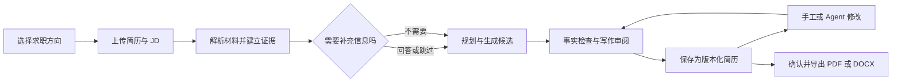

# Match-Trajectory

一个面向求职者的开源 AI 简历工作台：从旧简历、经历材料和岗位描述中提取证据，生成可编辑简历，并通过对话继续修改、核对和导出。

它的重点不是“让模型自由发挥”，而是让每次生成和修改都经过事实约束、版本记录和用户确认。

## 快速启动

### Docker Compose（推荐）

需要先安装 Docker Desktop，或 Docker Engine 与 Compose 插件。

```bash
git clone https://github.com/Dylanqxh/Match-Trajectory.git
cd Match-Trajectory
docker compose up --build -d
```

打开 [http://127.0.0.1:18765](http://127.0.0.1:18765)。

```bash
# 停止服务，保留数据
docker compose down

# 查看日志
docker compose logs -f
```

简历数据保存在 Docker 命名卷 `match-trajectory-data`。只有执行 `docker compose down -v` 才会删除该卷。

### 已配置的 Windows 开发环境

双击 `Start-App.cmd`，或运行：

```powershell
.\scripts\Start-App.ps1
```

## 怎么使用

1. 在“模型连接”中选择模型供应商，或填写自定义中转站的 Base URL、协议、模型 ID 和 Key。
2. 选择求职方向，上传旧简历、项目经历或 JD，也可以直接粘贴文本。
3. 生成候选简历；有必要时回答少量补充问题，也可以跳过。
4. 在编辑器中手工修改，或让右侧简历 Agent 执行压缩、重排、突出重点等操作。
5. 核对事实后导出 PDF 或可编辑 DOCX。

不连接模型时，仍可使用手工编辑、保存、版本管理和导出功能。

## 用户流程



## 系统架构


## 关键能力

| 能力 | 说明 |
| --- | --- |
| 证据驱动生成 | 数字、技能、责任、时间和结果必须能回到用户材料，不从 JD 推断个人事实 |
| 分岗位 Skill | 产品、后端、前端、测试、数据开发、算法、数据分析、运营等方向使用不同写作规则 |
| 受控简历 Agent | 支持压缩、改写、排序和重点标记；修改后重新经过事实检查 |
| 版本化编辑 | 手工编辑与 Agent 修改共享版本历史，支持差异查看和撤销，避免覆盖较新内容 |
| 可交付导出 | 页面预览、PDF 与 DOCX 使用同一份结构化简历内容 |
| 本地优先 | 简历、任务和导出文件保存在本机；服务默认只监听本机回环地址 |

## 模型连接

内置 OpenAI、Anthropic、DeepSeek 和阿里云百炼配置，也支持自定义中转站：

- OpenAI 兼容的 Chat Completions
- OpenAI Responses
- Anthropic Messages

连接测试只发送合成短文本，不发送简历。Key 不会写入项目文件；勾选“记住 Key”时只尝试保存到操作系统钥匙串，否则仅保留在当前服务内存。

第三方接口可先用安全诊断脚本测试：

```powershell
python tools\test_model_connection.py `
  --base-url https://relay.example.com/v1 `
  --model your-model-id `
  --protocol responses
```

## 数据与安全边界

- 姓名和联系方式由本地应用管理；发送给模型的材料范围由用户确认。
- 模型只能返回结构化候选，不能执行文件、命令或数据库操作。
- 引用检查和 AI 审阅不能证明事实绝对真实，最终内容仍需要用户核对。
- 模型连接成功只证明接口可调用，不代表生成质量、余额或长期可用性已经得到保证。
- `data/`、构建产物、密钥和测试产物均不会提交到 Git。

## 开发与验证

主要环境：Python 3.12、Node.js 22、React、FastAPI、SQLite、Playwright。

```powershell
# Windows 项目环境
. .\scripts\Enter-DevEnvironment.ps1

python -m pytest tests -q
npm run test:web
npm run typecheck
npm run build
```

跨平台使用建议优先走 Docker Compose；本机开发环境说明见 [docs/ENVIRONMENT.md](docs/ENVIRONMENT.md)。

## 设计文档

- [产品设计](docs/互联网求职简历Agent产品设计方案.md)
- [Agent 架构](docs/简历Agent架构设计方案.md)
- [Skill 设计](docs/简历Skill设计方案.md)

## License

项目采用 [MIT License](LICENSE)。第三方组件与字体许可见 [NOTICE](NOTICE)。
