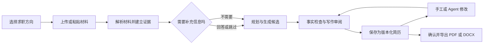
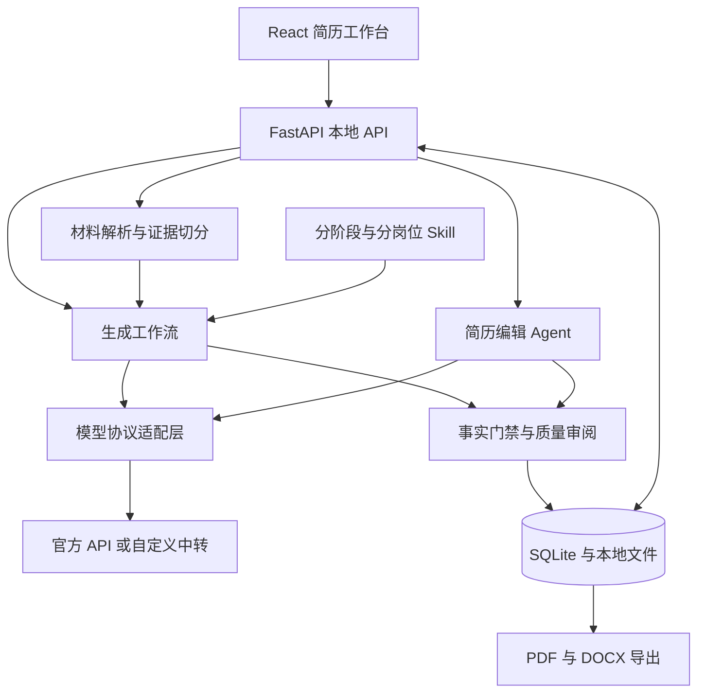
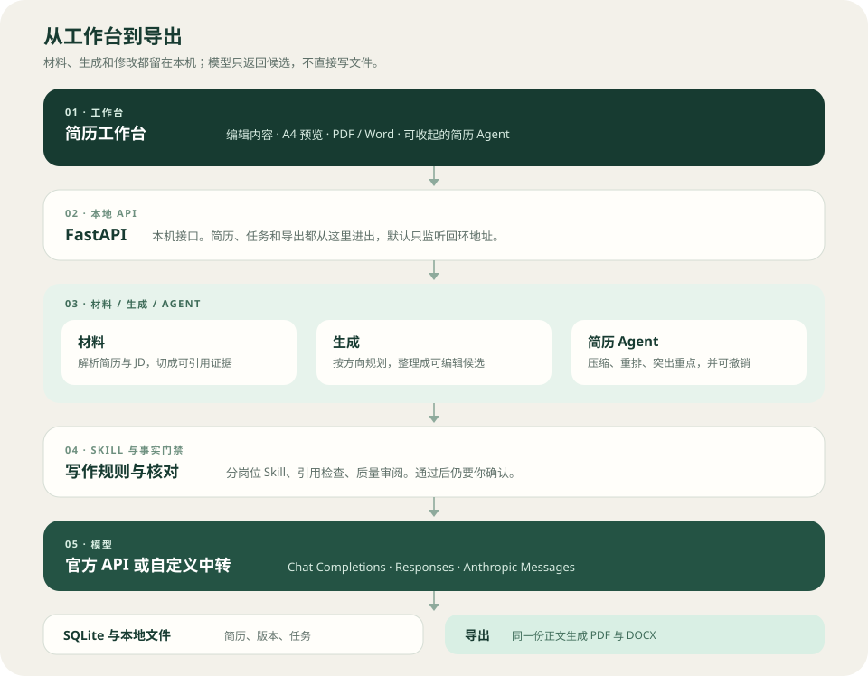

# Match-Trajectory

一个面向求职者的开源 AI 简历工作台：从旧简历、经历材料和岗位描述中提取证据，生成可编辑简历，并继续修改、核对和导出。

[](LICENSE)
[](pyproject.toml)
[](package.json)
[](compose.yaml)
[](app/main.py)
[](package.json)

<p align="center">
  
</p>

<p align="center">
  
</p>

## 快速启动

### Docker Compose（推荐）

需要 Docker Engine 与 Compose 插件（Docker Desktop 也可以）。

```bash
git clone https://github.com/Dylanqxh/Match-Trajectory.git
cd Match-Trajectory
docker compose up --build -d
```

打开 [http://127.0.0.1:18765](http://127.0.0.1:18765)。

```bash
docker compose down          # 停止服务，保留数据
docker compose logs -f       # 查看日志
```

简历数据在 Docker 命名卷 `match-trajectory-data` 里。只有 `docker compose down -v` 会删掉它。

### 已配置的 Windows 开发环境

双击 `Start-App.cmd`，或运行 `.\scripts\Start-App.ps1`。

已经有 `web/dist` 时，启动不会重新构建前端。拉到新界面后先显式重建；构建失败会停下来，不会继续打开旧页面：

```powershell
.\scripts\Start-App.ps1 -NoBrowser -RebuildFrontend
```

## 怎么使用

1. 在「模型连接」里选择供应商，或填写自定义中转的 Base URL、协议、模型 ID 和 Key。
2. 选择方向，上传或粘贴旧简历，岗位 JD 可选。
3. 确认发送范围后生成。需要补充时可以回答，也可以跳过。
4. 在编辑器和预览里修改。右侧简历 Agent 可以收成窄条；窄屏幕时它移到画布下方。
5. 核对事实后，从预览旁边导出 PDF 或 Word。

不连接模型时，仍可手工编辑、保存、查看版本和导出。

## 关键能力

- **证据驱动**：数字、技能、责任、时间和结果要能回到你的材料，不从 JD 推断个人事实。
- **分岗位 Skill**：产品、后端、前端、测试、数据开发、算法、数据分析、运营等方向使用不同写作规则。
- **简历 Agent**：压缩、改写、排序和重点标记；修改后重新经过事实检查，并自动保存版本。
- **版本可回看**：手工编辑和 Agent 修改共享历史，能看时间、来源，以及和上一版的差异。
- **同一份正文导出**：页面预览、PDF 和 DOCX 使用同一份结构化内容。
- **本地优先**：简历、任务和导出文件留在本机；服务默认只监听本机回环地址。

## 用户流程



## 系统架构





## 模型连接

内置 OpenAI、Anthropic、DeepSeek 和阿里云百炼，也支持自定义中转：

- OpenAI 兼容的 Chat Completions
- OpenAI Responses
- Anthropic Messages

连接测试只发送合成短文本，不发送简历。Key 不会写入项目文件；勾选「记住 Key」时只尝试保存到操作系统钥匙串，否则仅留在当前服务内存。

第三方接口可先用安全诊断脚本测试：

```powershell
python tools\test_model_connection.py `
  --base-url https://relay.example.com/v1 `
  --model your-model-id `
  --protocol responses
```

### 模型中转（可选）

自定义中转是可选项，不是本项目的官方服务。

如果需要稳定的第三方 API 来调用 GPT 等模型，可联系 QQ：2286141017。

## 数据与安全边界

- 姓名和联系方式由本地应用管理；发送给模型的材料范围由你确认。
- 模型只能返回结构化候选，不能执行文件、命令或数据库操作。
- 引用检查和 AI 审阅不能证明事实绝对真实，最终内容仍需要你核对。
- 模型连接成功只说明接口可调用，不代表生成质量、余额或长期可用性。
- `data/`、构建产物、密钥和测试产物不会提交到 Git。

## 开发与验证

主要环境：Python 3.12、Node.js 22、React、FastAPI、SQLite、Playwright。

```powershell
. .\scripts\Enter-DevEnvironment.ps1

python -m pytest tests -q
npm run test:web
npm run typecheck
npm run build
```

跨平台使用建议优先走 Docker Compose。本机开发环境说明见 [docs/ENVIRONMENT.md](docs/ENVIRONMENT.md)。

## 设计文档

- [产品设计](docs/互联网求职简历Agent产品设计方案.md)
- [Agent 架构](docs/简历Agent架构设计方案.md)
- [Skill 设计](docs/简历Skill设计方案.md)

## License

项目采用 [Apache License 2.0](LICENSE)。第三方组件与字体许可见 [NOTICE](NOTICE)。
