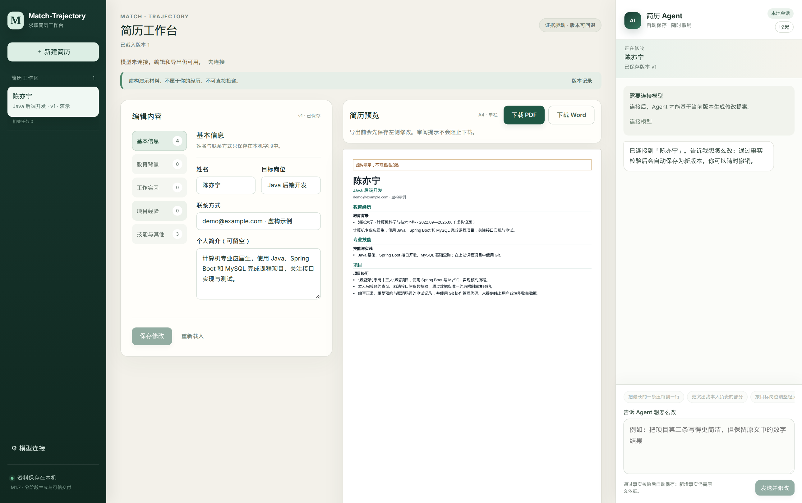
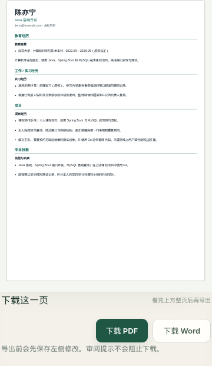
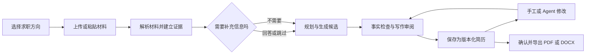
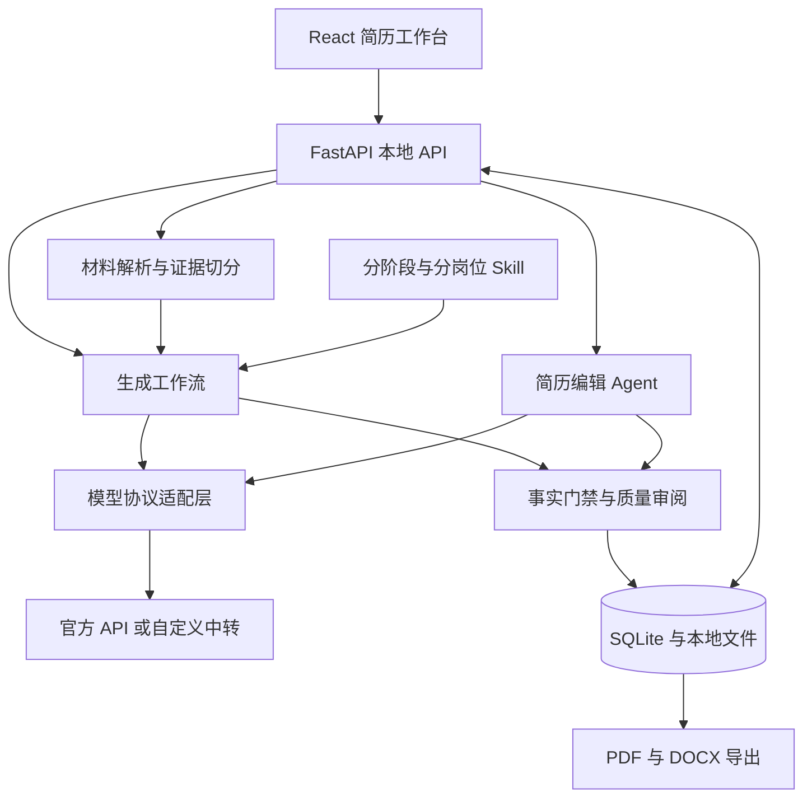

# Match-Trajectory

一个本地优先、证据驱动的开源 AI 简历工作台：把旧简历、真实经历和可选岗位 JD 整理成可编辑、可核对、可版本回看的简历，再导出 PDF 或 Word。

> **当前状态：持续开发中。** 已具备“材料采集 → 生成与补问 → 编辑核对 → 导出”的本地闭环；自动化测试验证的是程序行为，不代表真实模型写作效果，也不能替代本人事实核对。

[](LICENSE)
[](pyproject.toml)
[](package.json)
[](compose.yaml)
[](app/main.py)
[](package.json)

<p align="center">
  
</p>

<p align="center">
  
</p>

上图是应用内虚构示例「陈亦宁」的整页预览，学校、公司和经历都是虚构的，不可投递。

## 适合什么场景

- 你有旧简历、零散经历或一份岗位 JD，希望先整理事实，再按目标方向重写。
- 你希望看到模型用了哪些原文、哪里仍缺证据，并保留手工修改与历史版本。
- 你愿意自行配置模型 API，并希望简历数据默认留在本机。

它不是招聘网站，也不会自动投递；扫描件图片不做 OCR；AI 审阅只能发现可识别的问题，不能证明经历绝对真实。

## 快速启动

启动后统一访问 [http://127.0.0.1:18765](http://127.0.0.1:18765)。

### 已配置的 Windows 开发环境

如果当前项目旁已经存在配套的 `.dev-environment`，双击 `Start-App.cmd` 即可启动；也可以在 PowerShell 中运行：

```powershell
.\scripts\Start-App.ps1
```

拉取到新的前端改动后，显式重建，避免继续打开旧的 `web/dist`：

```powershell
.\scripts\Start-App.ps1 -NoBrowser -RebuildFrontend
```

全新机器不要假设环境已经就绪；跨平台首次使用优先选择下面的 Docker 方式，本机开发环境的组成和验证记录见 [docs/ENVIRONMENT.md](docs/ENVIRONMENT.md)。

### Docker Compose（跨平台推荐）

需要 Docker Engine 与 Compose 插件（Docker Desktop 也可以）。

```bash
git clone https://github.com/Dylanqxh/Match-Trajectory.git
cd Match-Trajectory
docker compose up --build -d
```

```bash
docker compose down          # 停止服务，保留数据
docker compose logs -f       # 查看日志
```

简历数据在 Docker 命名卷 `match-trajectory-data` 里。只有 `docker compose down -v` 会删掉它。

## 第一次使用

### 1. 连接模型并准备材料

在「模型连接」中选择 OpenAI、Anthropic、DeepSeek、阿里云百炼，或填写兼容中转的 Base URL、协议、模型 ID 和 Key。然后选择求职方向，并从两条材料路径开始：

- **上传已有简历**：上传 PDF、Word、TXT、Markdown，或直接粘贴已有文字。
- **从空白表单填写**：按教育、工作/实习、项目和技能逐项整理，不必先写成长文。

两条路径可以切换和组合，内容不会因切换入口而清空；岗位 JD 独立填写且可选。

### 2. 观察生成过程

确认发送范围后，任务进入独立生成工作区。页面只展示真实阶段状态，不伪造百分比；模型需要补充时最多追问一轮，可以回答，也可以跳过先看初稿。失败或中断时，原材料和已有版本不会被覆盖。

### 3. 编辑、核对与导出

初稿采用后进入文档工作区，可以在「并排查看」「专注预览」「专注编辑」之间切换。手工修改和简历 Agent 修改会进入同一版本历史；逐项核对事实后，再导出 PDF 或 Word。

不连接模型时，仍可手工填写、保存、查看版本和导出。

## 关键能力

- **证据驱动**：数字、技能、责任、时间和结果要能回到你的材料，不从 JD 推断个人事实。
- **双材料入口**：已有简历和结构化空白表单可以单独使用，也可以合并为同一次生成输入。
- **分岗位 Skill**：产品、后端、前端、测试、数据开发、算法、数据分析、运营等方向使用不同写作规则。
- **可恢复的生成工作区**：阶段状态、补问、候选草稿和失败恢复集中展示，不与材料表单和文档编辑混在一起。
- **简历 Agent**：压缩、改写、排序和重点标记；修改后重新经过事实检查，并自动保存版本。
- **三种文档视图**：并排修改、放大整页或集中填写，窄屏自动回到单列布局。
- **版本可回看**：手工编辑和 Agent 修改共享历史，能看时间、来源，以及和上一版的差异。
- **同一份正文导出**：页面预览、PDF 和 DOCX 使用同一份结构化内容。
- **本地优先**：简历、任务和导出文件留在本机；服务默认只监听本机回环地址。

## 能力边界

- PDF 必须包含可复制文字；扫描件、图片、加密文件和无法识别的旧格式需要改为粘贴文字。
- JD 只用于判断相关性和排序，不能成为候选人经历、技能或成果的事实来源。
- 模型输出、引用检查和 AI 审阅都可能出错；导出前必须由本人核对姓名、时间、数字、职责和结果。
- 当前没有证据证明它比通用对话产品更适合所有用户；仓库测试覆盖工程行为，不等于真实投递效果验证。

## 用户流程



## 系统架构




## 模型连接

内置 OpenAI、Anthropic、DeepSeek 和阿里云百炼，也支持自定义中转：

- OpenAI 兼容的 Chat Completions
- OpenAI Responses
- Anthropic Messages

连接测试只发送合成短文本，不发送简历。Key 不会写入项目文件；勾选「记住 Key」时只尝试保存到操作系统钥匙串，否则仅留在当前服务内存。

第三方接口可先用安全诊断脚本测试：

```powershell
python tools\test_model_connection.py `
  --base-url https://relay.example.com/v1 `
  --model your-model-id `
  --protocol responses
```

### 模型中转（可选）

自定义中转是可选项，不是本项目的官方服务。

如果需要稳定的第三方 API 来调用 GPT 等模型，可联系 QQ：2286141017。

## 数据与安全边界

- 姓名和联系方式由本地应用管理；发送给模型的材料范围由你确认。
- 模型只能返回结构化候选，不能执行文件、命令或数据库操作。
- 引用检查和 AI 审阅不能证明事实绝对真实，最终内容仍需要你核对。
- 模型连接成功只说明接口可调用，不代表生成质量、余额或长期可用性。
- `data/`、构建产物、密钥和测试产物不会提交到 Git。

## 开发与验证

主要环境：Python 3.12、Node.js 22、React、FastAPI、SQLite、Playwright。

```powershell
. .\scripts\Enter-DevEnvironment.ps1

npm run test:layout
npm run test:web
npm run typecheck
npm run build
python -m pytest tests -q
```

也可以运行 `.\scripts\Test-App.ps1` 完成后端测试、类型检查和生产构建。跨平台使用建议优先走 Docker Compose；本机开发环境说明见 [docs/ENVIRONMENT.md](docs/ENVIRONMENT.md)。

## 设计文档

- [产品设计](docs/互联网求职简历Agent产品设计方案.md)
- [Agent 架构](docs/简历Agent架构设计方案.md)
- [Skill 设计](docs/简历Skill设计方案.md)

## License

项目采用 [Apache License 2.0](LICENSE)。第三方组件与字体许可见 [NOTICE](NOTICE)。
