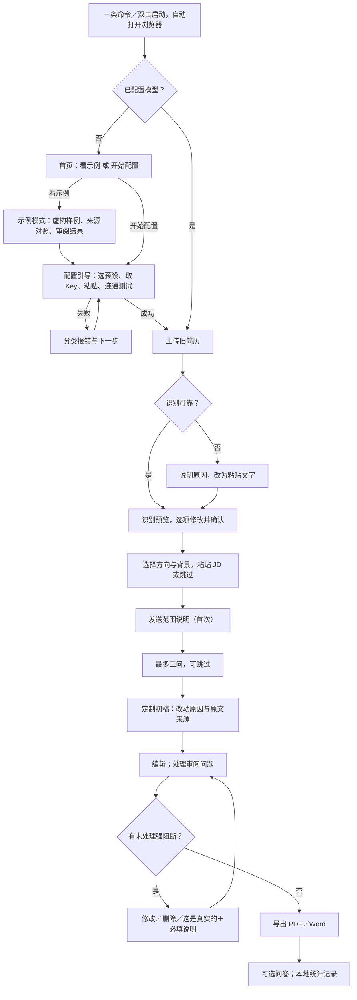
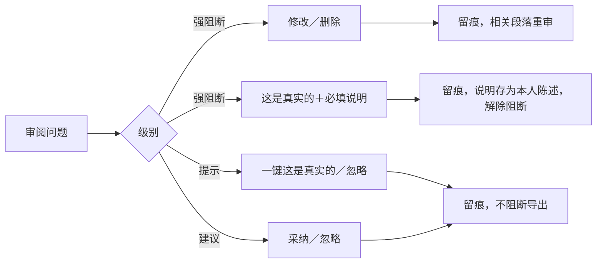

# PRD：下一迭代——快速上手、主流程与对照评测

v0.2｜2026-11-05｜状态：待研发评审｜依据：[产品方案](互联网求职简历Agent产品设计方案.md)（修订 8）· [Skill 方案](简历Skill设计方案.md) · 当前实现见 [README](../README.md)

本文只定义产品需求与验收标准，不指定技术方案。标注“待研发评估”的条目，由研发给出方案与工作量后再排期。

## 1. 背景与目标

项目定位为 GitHub 开源、自部署、本地优先的个人项目，不以盈利为目的；不做登录、账户、额度和收费。M1.7 已在 Windows 本机完成“生成 → 审阅 → 编辑 → 核对 → 导出”闭环，但：启动与首次配置门槛高；主要输入为粘贴文字；审阅阻断偏严；还没有证据回答“凭什么不直接用豆包”。背景详见[产品方案第 1—3 节](互联网求职简历Agent产品设计方案.md#1-背景与目标)。

**本迭代目标：**

1. 求职者几分钟内启动并看到示例，按引导配置 Key 后完成“上传旧简历＋粘贴 JD → 定制简历 → 导出”。
2. 审阅三级：只拦高置信编造，其余不阻断导出。
3. 建成对照评测工具链，完成首轮离线评测并发布报告（方案见[产品方案第 9 节](互联网求职简历Agent产品设计方案.md#9-对照评测方案凭什么不直接用豆包)）。
4. 本地统计可查看、可导出，为下一迭代的真人试用做好准备。

**本迭代完成条件（已定）：** 以首轮离线对照评测报告在仓库发布为完成条件；主流程须在 Windows、macOS、Linux 干净环境走通。不以评测“达标”为条件——不达标同样如实发布，并进入改进。真人试用顺延到下一迭代。

## 2. 现状：已有可复用 vs 需新增／调整

| 能力 | 现状（M1.7） | 本迭代 |
| --- | --- | --- |
| Windows 双击启动（`Start-App.cmd`）、便携包 | 已有，仅开发机验证 | 复用；**新增** macOS、Linux 支持（平台范围已定），启动方式待研发评估 |
| 模型连接：供应商预设、Key 填写、连通测试 | 已有 | **调整**为首次运行引导，补全分类报错 |
| Key 仅存于本次服务内存，重启需重填 | 已有 | **新增**可选本机保存 |
| 虚构示例体验、无模型手工路径 | 已有 | **调整**为示例模式：不配置 Key 可看预生成结果 |
| 分阶段生成、一轮最多三问可跳过、有限修正 | 已有 | 复用 |
| 五方向岗位规则、校招／社招／转岗背景 | 已有 | 复用；产品经理、后端为首发重点，其余标“未专项验证” |
| 可选 JD 粘贴、文字材料粘贴 | 已有 | 复用；JD 改为主流程一步（可跳过） |
| 独立审阅：事实结论＋四维写作质量 | 已有 | **调整**：映射为强阻断／提示／建议三级 |
| 逐项人工核对接管（引用原文＋说明） | 已有 | **调整**：保留；新增“这是真实的”快捷处理 |
| 编辑器、重审、候选采用为新简历不覆盖原简历 | 已有 | 复用 |
| PDF／DOCX 导出 | 已有 | 复用；**调整**带提示也可正式导出 |
| 删除简历／任务并确认范围 | 已有 | 复用；**新增**删除原始文件、一键清除本机全部数据 |
| 调用次数与时长预算、usage 记录、任务恢复与取消 | 已有 | 复用；usage 进入本地统计与评测 |
| 姓名、联系方式不发给模型，程序回填 | 已有 | 复用 |
| 评测工具：默认离线准备、显式运行、冻结材料与指纹、逐例 usage、人工评审模板 | 已有 | **扩展**：基线组、事实卡应答、盲评包、汇总报告 |
| 面试讨论点（辅助报告） | 已有 | 保持现状；追问生成能力复用于“可面试辩护率”评测 |
| 上传 DOCX／可复制文字 PDF 与识别预览 | 无 | **新增** |
| 本地统计与导出 | 无（无遥测） | **新增**，不含正文，不自动上传 |

## 3. 本迭代范围

| 做 | 不做 |
| --- | --- |
| 一键／一条命令启动、首次配置引导、示例模式 | 托管服务、登录、账户、额度、收费 |
| 上传 DOCX、可复制文字 PDF，识别预览与纠正 | 扫描件／图片 OCR、旧版 DOC、加密文件 |
| 旧简历＋JD 定制主流程；无 JD、纯文字兜底 | 岗位爬取、JD 链接抓取 |
| 审阅三级与“这是真实的” | 改写审阅模型或新增审阅角色 |
| 本地统计与主动导出 | 任何自动上传 |
| 对照评测工具链、首轮样本集与离线评测报告 | 真人试用（顺延到下一迭代）、统计显著性检验平台 |
| README 首屏、示例输出 | 静态在线演示页（P2，可选） |

## 4. 用户故事

| 编号 | 作为 | 我想要 | 以便 |
| --- | --- | --- | --- |
| US-1 | 求职者 | 一条命令或双击就能启动 | 不用先装开发环境 |
| US-2 | 求职者 | 不填 Key 先看到示例效果 | 判断值不值得配置 |
| US-3 | 求职者 | 配置 Key 时有引导，出错时知道怎么办 | 不卡在第一步 |
| US-4 | 求职者 | 上传已有简历并改正识别结果 | 不必重新整理材料 |
| US-5 | 求职者 | 粘贴 JD，得到针对该岗位的版本 | 投递更相关 |
| US-6 | 求职者 | 看到每处改动的原因和对应原文 | 每一句都能在面试中讲清楚 |
| US-7 | 求职者 | 被误判时一键说明“这是真实的” | 不被卡在导出前 |
| US-8 | 求职者 | 删除我的材料，或一键清空本机数据 | 放心使用 |
| US-9 | 求职者 | 查看并导出一份不含简历内容的统计文件 | 了解自己的使用情况；下一迭代用于试用回收 |
| US-10 | 维护者 | 批量跑产品组与基线组、导出盲评包、汇总结果 | 用证据回答“凭什么不直接用豆包” |
| US-11 | 仓库读者 | 在 README 首屏看到问题、示例和评测结论 | 快速判断项目价值 |

## 5. 功能需求

优先级：P0 本迭代必须；P1 应做，可视工作量顺延；P2 有余力再做；后续：已定顺延到下一迭代。

### 5.1 启动与首次配置

| 编号 | 需求 | 优先级 | 验收标准 | 现状 |
| --- | --- | --- | --- | --- |
| F1.1 | 一键／一条命令启动，启动后自动打开浏览器 | P0 | Windows、macOS、Linux（已定）未装开发环境的干净系统上，按 README 一步启动成功；各平台启动方式由研发评估（Q1） | Windows 已有，macOS／Linux 新增 |
| F1.2 | 首次运行配置引导：选供应商预设 → 官方取 Key 指引 → 粘贴 → 连通测试 | P0 | 不查文档能完成配置；不出现必填技术参数 | 已有，流程调整 |
| F1.3 | 分类报错 | P0 | Key 无效、余额不足、网络不通、限流、模型不可用至少分开提示，每类给出下一步；不显示原始堆栈与 Key | 部分已有 |
| F1.4 | 可选在本机保存 Key | P1 | 用户勾选后重启不需重填；可随时清除；Key 不进入日志、统计、导出 | 新增 |
| F1.5 | 端口占用、重复启动等启动问题有明确提示 | P1 | 常见问题不需看终端即可理解 | 部分已有 |

### 5.2 示例模式

| 编号 | 需求 | 优先级 | 验收标准 | 现状 |
| --- | --- | --- | --- | --- |
| F2.1 | 不配置 Key 可进入示例模式，查看预生成的虚构样例：旧简历、JD、产品输出、来源对照、审阅结果 | P0 | 首页一键进入；全程标“虚构示例”；不产生模型调用 | 部分已有 |
| F2.2 | 示例至少覆盖首发两个方向 | P0 | 产品经理、后端研发各至少 1 例，校招、转岗均有 | 新增 |
| F2.3 | 示例中可对照查看基线组输出 | P1 | 同一样例并排显示产品组与基线组结果，取自评测样本 | 新增 |
| F2.4 | 静态在线演示页（只展示示例，不处理任何用户数据） | P2 | 不启动程序即可浏览示例；待研发评估方式 | 新增 |

### 5.3 材料输入

| 编号 | 需求 | 优先级 | 验收标准 | 现状 |
| --- | --- | --- | --- | --- |
| F3.1 | 上传旧简历：DOCX、可复制文字的 PDF | P0 | 支持格式可上传；大小、页数限制在界面写明；超限明确提示 | 新增 |
| F3.2 | 识别预览：按教育、经历等展示识别结果，可逐项修改后确认 | P0 | 确认前不开始生成；修改后的内容即为生成依据；识别不全处标出 | 新增 |
| F3.3 | 识别不可靠时回退粘贴 | P0 | 扫描件、加密、乱码、无法识别时说明原因并给出粘贴入口，不当作已读懂 | 新增 |
| F3.4 | 粘贴 JD，作为主流程一步，可跳过 | P0 | 跳过后走无 JD 画像路径，结果中注明“未针对具体 JD” | 已有，流程调整 |
| F3.5 | 选择目标方向与求职背景 | P0 | 产品经理、后端研发置顶；其他方向标“未专项验证” | 已有，展示调整 |
| F3.6 | 纯文字粘贴输入（兜底） | P1 | 不上传文件也能完成全流程 | 复用 |
| F3.7 | 同一份旧简历针对多个 JD 生成多个版本 | P1 | 每份 JD 独立版本，不覆盖原简历与其他版本 | 部分已有 |

### 5.4 生成与展示

| 编号 | 需求 | 优先级 | 验收标准 | 现状 |
| --- | --- | --- | --- | --- |
| F4.1 | 一轮最多三问，可跳过 | P0 | 与现状一致 | 复用 |
| F4.2 | 每条表述可查看对应原文；相对旧简历的主要改动给出原因 | P0 | 点击任一条目可见来源片段；新增、删除、改写的条目有简短原因 | 部分已有，展示调整 |
| F4.3 | 进度、费用提示、失败原因可见，失败后材料不丢 | P0 | 与现状一致；生成前提示可能产生模型费用 | 复用 |

### 5.5 审阅与处理（规则定义见第 7 节）

| 编号 | 需求 | 优先级 | 验收标准 | 现状 |
| --- | --- | --- | --- | --- |
| F5.1 | 审阅结果分三级：强阻断、提示、建议 | P0 | 每条问题只属一级；强阻断仅限第 7 节类型；其余不阻断正式导出 | 调整 |
| F5.2 | 强阻断：修改、删除，或一键标记“这是真实的”并必填一句说明（已定） | P0 | 说明为空不能提交；提交后解除该阻断；说明作为本人陈述保存；现有逐项引用原文核对仍可用 | 部分已有，调整 |
| F5.3 | 提示：一键“这是真实的”或忽略 | P0 | 一次点击完成并留痕 | 新增 |
| F5.4 | 处理留痕 | P0 | 记录条目、级别、类型、处理方式、说明、时间、简历版本；不改写审阅原结论；导出文件不含标注 | 部分已有 |
| F5.5 | 编辑后受影响条目重新审阅 | P0 | 与现状一致 | 复用 |

### 5.6 编辑、导出与本地数据

| 编号 | 需求 | 优先级 | 验收标准 | 现状 |
| --- | --- | --- | --- | --- |
| F6.1 | 直接编辑、撤销、版本保存 | P0 | 与现状一致 | 复用 |
| F6.2 | 无未处理强阻断即可正式导出 | P0 | 有未处理提示时导出前显示数量，一步确认即可导出 | 调整 |
| F6.3 | PDF、DOCX 导出 | P0 | 与现状一致；三个平台上中文字体与版式一致 | 复用 |
| F6.4 | 首次生成前说明发送范围 | P0 | 说明发送给用户配置的模型服务、发送哪些内容、哪些字段不发送；建议查看服务商数据政策 | 部分已有 |
| F6.5 | 删除简历、任务 | P0 | 与现状一致 | 复用 |
| F6.6 | 删除原始上传文件及识别结果 | P0 | 删除后不可再访问；是否同时删除由其生成的简历由用户选择 | 新增 |
| F6.7 | 一键清除本机全部数据 | P0 | 清除材料、简历、版本、导出记录、统计与保存的 Key；先展示范围并二次确认 | 新增 |

### 5.7 本地统计

| 编号 | 需求 | 优先级 | 验收标准 | 现状 |
| --- | --- | --- | --- | --- |
| F7.1 | 本机记录第 8 节事件 | P0 | 默认开启但只存本机；任何情况下不自动上传 | 新增 |
| F7.2 | 统计查看与导出 | P0 | 界面可查看汇总；导出前展示文件全部内容；文件中不含正文、JD、姓名、联系方式、学校与公司名、Key | 新增 |
| F7.3 | 关闭统计、清除统计 | P1 | 关闭后不再记录；清除后不可恢复 | 新增 |
| F7.4 | 试用对照记录页（顺延到下一迭代，随真人试用） | 后续 | 试用者可粘贴通用大模型的初版与自己的最终版、填写起止时间，本地计算改动比例并计入导出文件（只导出数值） | 新增 |
| F7.5 | 导出后问卷（顺延到下一迭代，随真人试用） | 后续 | 导出后可选填写第 8 节问卷，结果只存本机并随统计导出 | 新增 |

### 5.8 对照评测工具链

| 编号 | 需求 | 优先级 | 验收标准 | 现状 |
| --- | --- | --- | --- | --- |
| F8.1 | 样本格式与首轮样本集 | P0 | 每例含旧简历、JD（或目标岗位）、补充事实卡、核心事实清单、禁止扩写清单、所属格；标明“虚构”或“已授权脱敏”；首轮至少 40 例，16 格按产品方案 9.3 配额；分开发集与保留集 | 构造案例已有，需改造补齐 |
| F8.2 | 批量运行三组：P 产品组、B1 基线单轮、B2 基线有限多轮 | P0 | 三组同一模型与参数，首轮为 DeepSeek（已定）；B1／B2 使用仓库中固定的提示词模板与追问脚本；可指定样本、组别、重复次数；默认离线准备，显式开启才发请求，有总调用与预算上限 | 产品组已有，基线新增 |
| F8.3 | 事实卡应答 | P0 | 产品组补问、B2 中模型提问，只按事实卡回答，卡上没有的回答“没有／不记得”；应答规则可复现并记录 | 新增 |
| F8.4 | 运行记录 | P0 | 每次输出记录样本、组别、模型、参数、规则与模板版本指纹、usage、估算费用、耗时、失败原因；失败计入结果不自动丢弃 | 部分已有 |
| F8.5 | 导出盲评包 | P0 | 各组输出转为统一纯文本格式；去除来源标识；随机编号与 A／B 位置；映射表单独保存不给评审者 | 新增 |
| F8.6 | 标注模板 | P0 | 支持逐条事实标注（6 类）、JD 关键要求 0／1／2、可读性 0／1／2、可辩护判断（能／部分／不能）、两两偏好及理由 | 人工评审模板已有，需扩展 |
| F8.7 | 追问生成 | P0 | 对每条表述生成 2 个面试官式追问，提示词固定、可复现；评审者可删改 | 面试讨论点已有，需改造 |
| F8.8 | 汇总与报告 | P0 | 回收标注后按组、按格汇总全部指标与成本，列出全部严重错误与失败案例，生成可放入仓库的报告草稿；措辞默认“在该 N 例样本上” | 新增 |
| F8.9 | 双人标注一致性 | P1 | 指定样本可分配给两名评审者，报告一致程度 | 新增 |
| F8.10 | LLM 辅助评审 | P2 | 可选用不同于生成模型的模型做预标注，交换 A／B 位置各评一次；结果与人工分开列出，并给出与人工子集的一致程度 | 新增 |
| F8.11 | 外部产品参考组录入 | P2 | 可手工录入在豆包等产品上得到的输出，标记为参考组，不进入主要结论 | 新增 |

### 5.9 仓库交付

| 编号 | 需求 | 优先级 | 验收标准 | 现状 |
| --- | --- | --- | --- | --- |
| F9.1 | README 首屏 | P0 | 一句话问题、示例前后对比截图、三步快速开始、设计文档链接；评测报告发布后加入主要结论与链接 | 调整 |
| F9.2 | 评测报告与样本随仓库发布 | P0 | 报告含方法、模板、样本、逐例结果、失败案例、成本与局限；可按说明复现 | 新增 |
| F9.3 | 常见报错与已知限制文档 | P1 | 覆盖 F1.3 各类报错与识别回退 | 部分已有 |

## 6. 交互流程

**首次使用与主流程：**

**审阅问题处理：**

**对照评测流程：**

## 7. 审阅提示／阻断规则（产品定义）

**原则：** 强阻断宁窄勿宽，只拦“面试被追问会说不清”的高置信问题；判断不确定一律降为提示。

| 级别 | 类型 | 示例 | 对正式导出 |
| --- | --- | --- | --- |
| 强阻断 | 无依据的数字 | 材料无规模数据，简历写“支撑百万级用户” | 阻断 |
| 强阻断 | 无依据的技能、机构、经历 | 材料未提及 Kafka，简历列为技能 | 阻断 |
| 强阻断 | 扩大个人责任 | 原文“参与需求评审”，简历写“主导需求设计” | 阻断 |
| 强阻断 | 改变状态 | “未上线／在投／仿真”写成“上线／发表／生产环境” | 阻断 |
| 强阻断 | 跨项目归属 | 把 A 项目的成果写进 B 项目 | 阻断 |
| 提示 | 证据不足 | 有动作但缺结果，表述偏向结果 | 不阻断 |
| 提示 | 表达偏夸张 | “显著提升”“大幅优化”无对应依据 | 不阻断 |
| 提示 | 可能偏离原意、来源有歧义 | 模型审阅认为语义可能不一致，但无确定冲突 | 不阻断 |
| 提示 | 岗位差距 | JD 要求的能力材料中没有 | 不阻断，也不建议包装 |
| 建议 | 结构、措辞、长度、版面 | 简介过长、条目过多 | 不阻断 |

**用户处理与留痕：**

| 级别 | 可选操作 | 必填 | 留痕字段 |
| --- | --- | --- | --- |
| 强阻断 | 修改、删除、一键标记“这是真实的” | 标记时一句说明（已定） | 条目、类型、原结论、操作、说明、时间、简历版本 |
| 提示 | 这是真实的、忽略、修改 | 无 | 同上（说明可空） |
| 建议 | 采纳、忽略 | 无 | 操作与时间 |

**文案要求：** 用事实描述，不指责。如“在你的材料中没有找到‘百万级’相关内容，面试被问到时能说明吗？”，而非“检测到编造”。

**误判治理：** 本地统计按强阻断类型记录“这是真实的”比例；下一迭代真人试用回收后，比例持续偏高的类型复核规则，必要时降为提示。阈值在首轮数据后确定。

## 8. 本地统计：事件与指标

**统一约束：** 只存本机；只记录行为、数值与枚举，不记录简历正文、JD 原文、姓名、联系方式、学校与公司名、Key。每个事件带：本地随机安装 ID（不关联身份）、任务 ID、时间、方向、求职背景、有无 JD、输入方式。

| 事件 | 触发 | 关键属性 |
| --- | --- | --- |
| app_start | 启动 | 是否首次、是否已配置模型 |
| demo_view | 进入示例模式 | 查看的示例编号 |
| setup_result | 连通测试 | 成功／失败类别、从首次启动到成功的时长 |
| task_start | 开始新定制 | 输入方式（上传／粘贴） |
| upload_result | 识别完成 | 文件类型、成功／部分／失败、失败类别 |
| parse_confirm | 识别预览确认 | 用户修改条目数 |
| jd_step | JD 步骤完成 | 粘贴／跳过 |
| questions | 补问结束 | 问题数、回答数、跳过数 |
| draft_ready | 初稿生成 | 耗时、调用次数、token、估算费用、失败类别 |
| review_item_action | 处理审阅问题 | 级别、类型、操作、是否填写说明 |
| edit_session | 每次保存 | 改动字符数、改动段落数 |
| export | 导出 | 正式／草稿、格式、未处理提示数、相对初稿改动比例、是否“大改” |
| survey_submit | 提交问卷 | 各题选项 |
| step_abandon | 关闭时停留在未完成步骤 | 所在步骤、停留时长 |

**指标定义：**

| 指标 | 定义 |
| --- | --- |
| 首次配置时长 | 首次启动到首次连通测试成功的时长；另记失败类别分布 |
| 开始到导出时长 | task_start 到首次正式 export；等待补问的时间单列 |
| 导出前改动比例 | 导出正文相对 AI 初稿正文的字符级编辑距离 ÷ 初稿字数 |
| 未大改直接导出比例 | 正式导出中无经历段落被整段重写的占比；建议单段改动比例超过 50% 视为整段重写，待首轮数据校准 |
| 单次成本 | 每次定制的 token 与估算费用（含重试与重审）；价格未知标未知 |
| 步骤放弃率 | 到达某步骤但未进入下一步的任务占比 |
| 强阻断误判率代理 | 各类强阻断中选择“这是真实的”的比例 |

事实错误、可面试辩护率、JD 相关性等质量指标来自对照评测的人工标注，不来自本地统计。

**导出后问卷（下一迭代随真人试用上线，可选，不超过 4 题）：**

1. 对这份简历的满意度（1—5）。
2. 你会直接用它投递吗？（会／改一改再用／不会）
3. 简历上的每一句，面试被追问时你都能讲清楚吗？（都能／大部分能／有不少讲不清）
4. 和你以前改简历的方式比，更省事吗？（更省事／差不多／更麻烦）

## 9. 隐私数据要求（产品层面）

| 要求 | 说明 |
| --- | --- |
| 本地存储 | 全部数据只存本机；项目不运营服务器，不收集数据 |
| 发送范围透明 | 首次生成前说明：材料发送给用户配置的模型服务；姓名、联系方式不发送；正文中的隐私会随正文发送 |
| 无遥测 | 不自动上传任何内容，包括统计、错误报告 |
| Key | 只存本机；不进入仓库、日志、统计、导出文件、评测报告 |
| 删除 | 删除简历、任务、原始文件；一键清除全部；备份恢复不能让已删数据重新出现 |
| 统计导出 | 用户主动发起，导出前展示全部内容 |
| 评测材料 | 只用虚构或书面授权并脱敏的材料；与用户真实数据分开；真实简历不进入仓库 |

## 10. 非目标

- 托管服务、登录、账户、额度、收费与付费点。
- 面试追问准备、经历深挖（下一阶段；评测用到的追问生成只作测量工具）。
- 投递管理、岗位爬取、自动投递、模拟面试。
- 个人偏好学习；收集用户修改（只接受用户主动提交）。
- 扫描件／图片识别、英文简历。
- 编排架构演进（受控 Supervisor 扩展、多 Agent 拆分）；继续按 [Agent 方案](简历Agent架构设计方案.md)。
- 社招及首发两方向之外的专项优化。

## 11. 待研发评估的问题

| 编号 | 问题 | 需要研发给出 |
| --- | --- | --- |
| Q1 | 三个平台的启动方式（平台范围已定：Windows、macOS、Linux） | 各平台可选方式（安装包、脚本、容器等）、包体大小、首次启动耗时、维护成本，及推荐方案 |
| Q2 | Key 本机保存 | 各平台可行的保存方式与风险；清除方式 |
| Q3 | 分类报错 | 各供应商返回的错误能否可靠区分 Key 无效、余额不足、限流、网络、模型不可用 |
| Q4 | 是否支持本地模型 | 可行性、对质量与速度的影响、是否值得在本迭代做 |
| Q5 | 上传解析 | DOCX、可复制 PDF 的识别可靠度预期；哪些版式无法可靠识别；预览纠正的实现成本 |
| Q6 | 审阅三级落地 | 现有审阅输出如何映射到三级；哪些强阻断类型可由程序高置信判断、哪些依赖模型 |
| Q7 | 评测工具扩展 | 在现有评测工具上增加基线组、事实卡应答、盲评包、汇总报告的工作量；B2 追问脚本如何自动执行 |
| Q8 | 评测预算（主模型已定：DeepSeek） | 先用 DeepSeek 小批量实测 usage 与费用，再按 40 例 × 3 组 ＋ 重复运行估算首轮预算，供确定预算上限 |
| Q9 | 本地统计 | 存储与导出方式；如何保证不混入正文 |
| Q10 | 示例模式与静态演示页 | 预生成示例的维护方式；静态演示页是否值得做 |

## 12. 里程碑与验收

| 里程碑 | 内容 | 验收 |
| --- | --- | --- |
| M-A 快速上手 | F1、F2：三平台启动、配置引导、分类报错、示例模式 | 三个平台干净环境中启动并看到示例；配置成功后完成一次生成 |
| M-B 主流程 | F3—F6：上传＋JD、来源展示、三级审阅、导出与本地数据删除；F7.1—F7.2 本地统计 | 三个平台走通“上传 → 定制 → 处理审阅 → 导出”；统计导出文件不含正文 |
| M-C 首轮离线评测（完成条件） | F8、F9：样本集、DeepSeek 小批量实测费用后定预算、三组运行、人工盲评、报告发布、README 首屏 | 评测报告与样本在仓库发布，可按说明复现 |
| 下一迭代 | 真人试用：F7.4 对照记录页、F7.5 问卷、6—12 名试用者交叉试用 | 不属于本迭代验收 |

## 13. 已定事项

| 事项 | 结论 |
| --- | --- |
| 强阻断解除方式 | 一键标记“这是真实的”＋必填一句说明 |
| 登录、账户、额度、收费 | 不做 |
| 首发平台 | 同时支持 Windows、macOS、Linux；具体启动方式由研发评估（Q1） |
| 首轮评测主模型 | DeepSeek；先小批量实测费用再定预算（Q8，预算待实测） |
| 本迭代完成条件 | 首轮离线评测报告发布；真人试用顺延到下一迭代 |
