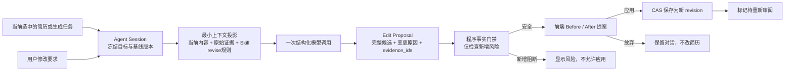

# 上下文型简历 Agent 与工作台改版设计

## 意图

把当前右侧“材料收集助手”改成真正围绕当前简历或生成任务工作的编辑 Agent。用户应当能用自然语言提出修改要求，先看清具体改动与依据，再决定是否应用为新版本；Agent 不能绕过事实校验、版本历史或人工确认。

## 当前问题

- `ChatService` 的会话只保存一个生成任务，职责是解析材料并触发生成，不知道当前打开的简历和版本。
- 对话切换简历时不会切换上下文；右栏再次提供上传入口，与主画布重复。
- 现有“缩短／补人数”只是重新跑生成任务，不是基于当前版本的可审阅编辑。
- 界面由左侧列表、中间长表单、右侧窄折叠条组成，层级弱、空白失衡、Agent 的作用域不可见。

## 目标与非目标

### 目标

1. 每个 Agent 会话绑定一个 `resume + revision` 或一个拥有候选的生成任务。
2. 用户用对话提出修改；Agent 读取当前内容、原始证据、岗位规则和最近对话。
3. Agent 只产出结构化提案，不直接写数据库；界面展示修改前、修改后、原因和引用。
4. 应用提案时用版本 CAS 防止覆盖新编辑，并保存为新的简历版本。
5. 新增事实风险由程序门禁阻止；姓名、联系方式和学校不发送给模型。
6. 工作台明确区分导航、当前文档、Agent 三个区域，并在窄屏下自然堆叠。

### 非目标

- 不让模型直接获得保存、删除、确认事实或导出工具权限。
- 不把聊天内容当作新的个人事实；补事实仍需进入材料或人工核对流程。
- 不在本轮实现多人协作、云端会话、流式 token 或长期偏好学习。
- 不宣称一次写作调用等于独立事实审阅；应用后仍标记为待重审。

## 方案比较

1. **扩展旧材料助手**：增加目标字段，继续在同一状态机里收集材料、生成和编辑。改动最少，但状态与文案继续混乱，旧会话也难以解释。
2. **上下文型提案 Agent（采用）**：单独的 Agent 会话与提案服务；旧材料上传保留在主流程。写入前经过提案预览、事实门禁和版本 CAS，职责清晰。
3. **自主工具 Agent**：模型直接调用保存、审阅、删除等工具。交互最自由，但当前的证据、预算和恢复协议不足以安全支撑，误写成本最高。

## 架构

## 数据与接口

### Agent 会话

新增独立 `agent_sessions` 表，不迁移旧 `chat_sessions`。会话保存：

- `target_type`: `resume | job`
- `target_id`
- 当前解析后的目标、基线 revision/hash
- 最近 40 条用户可见消息
- 至多一个当前提案及其 `ready | blocked | applied | discarded` 状态
- `idle | running | error` 执行状态

同一个目标重复打开时复用会话。若生成任务已经采用，则解析为对应简历；未采用的完成任务以候选为基线，应用时先物化为简历，再保存 Agent 版本。

### HTTP 契约

- `POST /api/agent/sessions`：传 `{target_type, target_id}`，创建或复用目标会话。
- `GET /api/agent/sessions/{id}`：刷新消息、目标和提案状态。
- `POST /api/agent/sessions/{id}/messages`：传修改要求，返回结构化提案。
- `POST /api/agent/sessions/{id}/proposals/{proposal_id}/apply`：CAS 应用并返回新简历版本。
- `POST /api/agent/sessions/{id}/proposals/{proposal_id}/discard`：放弃提案，不改变简历。

## Agent 上下文与安全边界

- 模型收到：去除姓名、联系方式、学校后的当前内容；原任务证据；岗位与 `revise` 阶段 Skill；用户本次要求；最近少量对话。
- 模型不收到：Key、真实姓名、联系方式、学校、数据库对象、确认状态、导出权限。
- 用户修改要求只决定编辑意图，不自动成为事实证据。
- 模型输出完整 `ResumeContent` 和每个实际变更的理由、引用 ID；程序根据基线重新计算真实 diff，不信任模型自报的改动范围。
- 新增/改变的条目通过现有 `validate_draft` 与 `blocking_gates`。只展示相对基线新增的阻断，避免把旧问题误报为本轮引入。
- 应用时再次检查简历 revision 或任务 draft hash；不一致返回冲突并要求重新生成提案。
- 保存沿用 `ResumeStore.save`，因此新版本自动失效旧审阅结论并保留版本历史。

## 交互设计

### 桌面

- 左栏：深色、低噪音的本地导航，突出当前简历/任务，删除操作降级为悬浮动作。
- 中间：当前文档与主要操作；新建流程仍负责方向、材料和生成，不再在 Agent 重复上传。
- 右栏：常驻“简历 Agent”工作区。顶部明确显示“正在修改：简历名 · vN”或“正在讨论：生成任务”。
- 无目标时显示空状态“先选择一份简历或已有候选”；不创建无归属聊天。
- 对话输入示例为“把第二条压缩到一行”“更突出我负责的接口性能优化”“按这个 JD 调整顺序”，不再提示上传材料。
- 提案卡逐项显示 Before / After、原因和原文引用数量；有风险时显示原因且禁用应用。

### 窄屏

- 顶部保留横向简历/任务切换；主文档在前，Agent 作为下方完整面板，不使用 64px 竖排文字。
- 所有按钮与输入保持至少 44px 可点击高度；提案 diff 单列显示。

## 状态与失败处理

- 模型未连接：保留目标和历史，只禁用发送，并提供“连接模型”。
- 模型失败：添加安全错误消息，不丢当前内容，不产生提案。
- 新请求到来时已有待处理提案：要求先应用或放弃，避免多份候选争抢同一基线。
- 版本冲突：不自动重放付费请求；提示“内容已变化，请基于最新版本重新提出修改”。
- 任务仍运行或没有候选：Agent 面板只显示等待状态，不创建可编辑提案。

## 验收

- 切换不同简历或任务时，Agent 顶部目标、消息和提案同步切换。
- 上传控件只存在于新建主流程，Agent 面板不再收集材料。
- Agent 提案不会直接改变简历；应用后 revision 增加，版本历史保留。
- 并发编辑后旧提案无法应用。
- 外部事实、姓名、联系方式、学校和 Key 不进入模型请求。
- 现有生成、采用、手工编辑、审阅和导出流程继续通过回归。
- 桌面和 745px 窄屏无横向页面溢出，控制台无错误。

