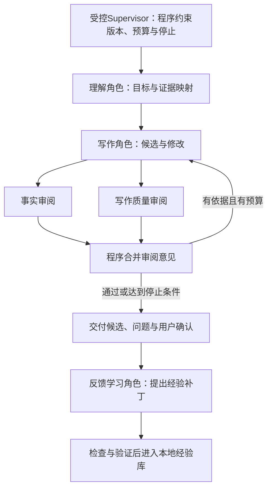

# Match-Trajectory：互联网求职简历产品方案

2026-11-03｜修订 6：保留 M1 基线，明确 Supervisor 兼容升级与可选反馈学习｜实现进度见 [README](../README.md)

> **让互联网求职者用少量材料、少量交互，得到一份岗位相关、事实可靠、只需局部修改的简历。**

| 文档 | 回答什么 |
| --- | --- |
| 本文 | 为谁做、交付什么、怎样判断有用 |
| [Skill 设计](简历Skill设计方案.md) | 好简历的标准、选材与写法、岗位差异 |
| [Agent 架构](简历Agent架构设计方案.md) | 阶段执行、模型与工具、状态保存、异常恢复和部署 |

三份文档分别维护自己的规则，避免重复描述；均为设计，不能视为产品效果证明。

## 1. 背景与目标

用户通常有零散经历，却不擅长选材、组织表达、写提示词和排版。产品承担这些组织工作，先解决一次简历交付，面试、投递管理和长期提升后置。

**好简历让招聘方有依据地判断“值得面试”：适配、有竞争力、可信、易读。** 具体标准见 Skill 方案。简历不能制造用户尚未具备的能力，也不承诺筛选通过或录用。

“70%—80% 可用”是待验证目标：用户认可主要内容和结构，仅需局部修改就愿意申请；不能用模型自评分替代。

## 2. 用户与首版范围

面向互联网求职者，同时覆盖校招、社招和转岗。技术／非技术只是入口导航；按目标方向、实际经历与责任范围、材料状态组合处理，不要求用户理解公司职级，不做跨公司等级映射。

| 范围 | 首版决定 |
| --- | --- |
| 重点验证 | 后端研发、算法、数据分析、产品经理、内容／用户运营 |
| 算法差异 | 通用实验规则，并用推荐／搜索、NLP、计算机视觉案例验证；不强制论文或部署经验 |
| 其他方向 | 通用规则试用，明确未专项验证；数据工程、QA、HR、设计等逐步扩展 |
| 输入 | 目标岗位＋文本、TXT、DOCX、可读取文字的 PDF；具体 JD 可选 |
| 输出 | 中文、A4 单栏、一至两页；可编辑预览、PDF、DOCX，支持版本复用 |
| 暂不交付 | 岗位爬取、自动投递、模拟面试、成长计划、多用户公网服务、英文专项优化 |

不因学历、专业或年限推断能力。缺少工作经历时使用真实课程、实践或作品；有经验时优先筛选相关责任与成果；转岗时说明可迁移经验和真实缺口。

## 3. 没有 JD 是默认路径

| 用户输入 | 系统动作 | 结果 |
| --- | --- | --- |
| 只有目标岗位 | 自动匹配内置岗位画像，选择已有证据 | 面向同类岗位批量投递的基础简历 |
| 岗位名称宽泛 | 先用材料识别方向；必要时用一个问题澄清，可跳过 | 保守基础版，用户可纠正 |
| 有具体 JD | 结合明确要求重新选材，保留真实差距 | 独立定制副本，不覆盖基础版 |

画像由维护者归纳公开 JD，包含核心能力、可选子方向、证据类型、来源和复核日期；随版本内置，运行时不依赖联网搜索。首版五方向各至少六份 JD、至少两家公司，覆盖校招和社招；只发布必要摘要与来源。每次发布复核，超过 90 天未复核提示时效。

画像提供关注点，不能冒充某家招聘要求，更不能写成用户技能。没有具体 JD 时不凭空设学历、年限等硬门槛。一份基础简历面向相近岗位；跨研发、算法、产品等方向时分别生成版本。

## 4. 用户怎样完成一次任务

工作台以预览和直接编辑为主，对话用于补充与修改。AI 改动显示前后差异与原因，可接受、拒绝、撤销；刷新后能继续。保存状态和失败原因必须可见。

材料少则保守表达，材料多则筛选。只有目标、没有个人事实时给明确标识的框架与补充入口，不虚构经历，不计为可用简历。事实争议先澄清；缺数字不强制补数字。

本期闭环是“输入 → 生成 → 修改 → 文件交付 → 版本复用”。导出不等于投递，也不等于完成整个求职过程。

## 5. 竞品启发与价值假设

截至 2026-11-02 的官方公开资料归纳，未全面实测；商业产品内部 Agent 实现保留未知。

| 参考 | 借鉴点 |
| --- | --- |
| [Resume Matcher](https://github.com/srbhr/Resume-Matcher) | 个人主材料与岗位版本分开，检查与导出相连 |
| [Reactive Resume](https://github.com/reactive-resume/reactive-resume) | 可编辑、AI 修改确认、版本恢复和多格式导出 |
| [Jobscan](https://www.jobscan.co/) | 用岗位差距解释修改，不把工具分数当录用概率 |
| [Teal](https://www.tealhq.com/) | 岗位与材料关联；申请过程管理可后置 |

拟验证的价值：面向中文互联网求职，在无 JD、材料零散时减少准备和修改负担。开源、Agent、自选模型本身并非独有优势。

当前短板是缺少真实效果、行业规则积累、成熟编辑体验和招聘渠道；不能据设计宣称优于成熟产品。

## 6. 普通用户如何开始

Windows 11 x64 提供便携包，解压、双击启动，无需安装 Python、Node、Docker 或 Office；开发者可用源码，熟悉部署者可用 Linux amd64 Docker。具体打包与数据方案见 Agent 文档。

**安装免开发环境，模型连接仍有门槛。** 首次先用虚构案例体验；实际生成采用“选预设 → 按官方指引取得 Key → 粘贴 → 测试”的向导，不要求填写技术参数。

v0.1 需要用户自己的供应商账户、调用权限和费用；至少两种供应商／模型组合通过验证才列入支持。真正免 Key 需要托管服务承担鉴权、额度、费用和运维，本期不作此承诺；本地模型和其他原生平台包后续验证。

默认本地保存，无默认遥测；远程生成前说明会发送的材料。支持删除与备份恢复，个人资料不进入公共仓库。

## 7. 什么才算交付

| 验证 | 通过条件 |
| --- | --- |
| 岗位场景 | 五方向×校招／社招×完整／稀疏材料×有／无 JD，共 40 个计划场景，另加反例；逐例检查事实与岗位表达 |
| 真实试用 | 至少 20 人，五方向各不少于 4 人，各含校招、社招；总体至少 75% 认可初稿只需局部修改、90% 独立编辑导出，人数向上取整；20 人时为 15、18 人 |
| 稀疏材料 | 至少 10 人、每方向至少 2 人，其中至少 6 人同时无 JD；稀疏组和交集组均独立满足 75% 初稿认可、90% 独立编辑导出，人数向上取整 |
| 无 JD 默认路径 | 至少 12 人、每方向至少 2 人；子组至少 75% 认可初稿、90% 独立编辑导出，人数向上取整；12 人时分别为 9、11 人 |
| 各方向 | 各方向至少 75% 认可初稿、75% 独立编辑导出，人数向上取整；4 人时各至少 3 人。内容评测也须通过 Skill 方案的方向判据，不能只看总体成绩 |
| 小白首次连接 | 上述用户含至少 5 名无 API 配置经验者；至少 80% 独立连接并完成首次生成，人数向上取整，5 人时至少 4 人；维护者不代填 |
| 时间与成本 | 已配置模型后，初稿 P90 两分钟内、编辑导出中位数十分钟内为目标；另外记录首次开通、取 Key、连接与放弃成本 |
| 安装与可靠性 | 干净 Windows／Docker 完成启动、中文导出、重启、故障恢复、取消、删除、备份与恢复 |

“局部修改”指核心经历不用整段重写、不用重新组织整份结构。“稀疏材料”指有至少一条本人学习、实践或工作线索，但缺本人动作、方法或结果等关键内容，无法直接作为完整简历使用。分组在试用前确定；开始后的配置、生成或操作失败计为失败，不能事后排除。有个人线索但生成不足也计失败；仅零个人事实的框架另测，不占试用名额。

每个子组分别报告人数与成功数，重叠用户可进入各自子组，不把组数相加当总人数。无 JD、稀疏材料、小白或某方向未过时，修复复测；仍可发布明确标识的预览版，但不能宣称五方向全部通过专项验证。

严重事实错误必须修正并回归；质量分数不能抵消虚构。与无 Skill／单次提示基线比较，分别记录模型、规则、耗时、费用和用户修改。小样本通过只支持发布试用版，不能推导到所有人群。

现有八组成套案例是构造研究材料，不是产品生成或真实用户效果证明；40 个场景仍待补建。

## 8. 实施、资源与 GitHub 发布

| 阶段 | 交付重点 |
| --- | --- |
| M0：可行性 | 两种模型接入、中文文件交付、干净 Windows 打包探针 |
| M1：生成闭环 | 五方向画像与规则、无 JD 初稿、少量补充、事实检查与局部修改 |
| M2：可靠使用与反馈积累 | 完善配置、版本、数据管理；逐步增加有作用范围、可撤销的偏好与写作经验，见第 9 节 |
| M3：公开试用 | 行业审阅、真实试用、兼容清单、便携包／镜像和实际评测记录 |

需要至少 30 份公开 JD、五方向各一名有用人经验的审阅者、20 名授权用户、两种模型组合与预算、Windows／Linux 构建环境及维护账户。资源尚未全部取得；不足时如实发布预览版或标记未验证方向。

GitHub 交付包含源码与锁文件、三份设计方案、快速开始、连接与故障指引、便携包及校验值、固定版本镜像、备份方法、岗位规则与来源、虚构测试集和评测报告、自动检查、Issue／安全反馈入口、已知限制与版本记录。

项目代码和自编规则拟采用 Apache-2.0；第三方代码、字体、浏览器和资料单独核验许可并保留声明，不提交真实简历、Key 或未经许可的 JD 全文。

**完成标志：** 没有维护者开发环境、不了解职级的用户，能按向导连接模型，只给目标岗位和不完整材料，得到真实边界内的简历，完成修改导出，失败后仍能恢复或手工继续。实际实现与效果必须由测试证明。

## 9. M1 之后：让每次修改帮助下一次写作

2026-11-03 调研补充，**以下为建议设计，尚未开发**。目标仍是提高简历效果、减少用户修改，不扩展为完整职业规划平台。

### 9.1 先看清当前基础与真正缺口

M1 已按岗位、求职阶段和执行阶段组合 Skill，并提供事实／写作质量两组审阅结果；不是先写通用稿，再机械套一遍岗位规则。当前主要输入仍为粘贴文字，文件／图片解析尚未落地。

当前循环主要改进**这一份简历**。用户把长段改短、把某段项目提到前面，下一次任务还不能可靠复用这些调整。拟增加的能力是：**在本地积累有依据、适用范围清楚、可以撤销的偏好和写作经验。**

这属于上下文与规则适配，不要求每位用户重新训练大模型参数。简历效果还取决于材料、选材、目标理解和模型能力，不能只归因于 Skill 长短或 Agent 数量。

### 9.2 调研中值得借鉴的设计

下表依据官方文档、作者仓库和工程文章；仅确认公开机制，未在本产品实测其效果。右栏是针对本产品的设计判断。

| 参考 | 公开机制 | 我们借鉴什么 |
| --- | --- | --- |
| [LangChain Memory](https://docs.langchain.com/oss/python/concepts/memory)、[LangMem](https://langchain-ai.github.io/langmem/reference/prompt_optimization/) | 区分事实、经历和行为规则；可从交互轨迹与反馈提出提示词更新 | 个人事实、写作偏好、可复用方法分别保存；把反馈分析与当前生成分开 |
| [ACE](https://github.com/ace-agent/ace) | Generator、Reflector、Curator 分工，通过增量更新整理经验条目 | 学习小范围规则补丁，去重、合并、淘汰，避免反复覆盖整份 Skill |
| [DSPy GEPA](https://dspy.ai/current/api/optimizers/GEPA/overview/) | 用执行轨迹与文本反馈提出候选指令，并在验证集比较 | 修改规则后要比较新旧效果，不能由学习者自评就宣布优化成功 |
| [ReasoningBank](https://github.com/google-research/reasoning-bank) | 从成功和失败轨迹提炼可复用经验；公开实现面向代码与网页任务 | 同时记住“哪种写法被接受”和“为什么被拒绝”，不保存一堆无法复用的聊天摘要 |
| [Anthropic 工作流](https://www.anthropic.com/research/building-effective-agents)、[多 Agent 工程实践](https://www.anthropic.com/research/multi-agent-research-system) | 生成与评价可分开；多 Agent 适合可独立分工的任务，也增加成本与协调负担 | 先分清理解、写作和审阅职责；拆分是否保留，以简历对照结果决定 |
| [Anthropic 2026 年工程设计](https://www.anthropic.com/research/managed-agents) | 将会话记录、执行循环和工具环境通过稳定接口解耦 | 继续让本地程序管理数据、预算和版本，模型角色可以替换；不因此迁移到托管服务 |

### 9.3 自适应 Skill：稳定核心＋可变补充

| 层 | 放什么 | 怎样更新 |
| --- | --- | --- |
| 基础 Skill | 选材方法、质量标准、事实与交付边界 | 随项目版本维护，个人反馈不能降低事实标准或改写评测规则 |
| 岗位与阶段规则 | 不同方向的证据重点、校招／社招／转岗写法 | 维护者更新；本地可提出范围明确的改进候选，经验证再启用 |
| 个人偏好 | 简介是否保留、表达长短、本人希望突出的侧重 | 按用户、目标方向和场景保存，明确作用域，可查看、修改、关闭 |
| 写作经验与样例 | 某类材料怎样改写更有效、被接受／拒绝的写法及原因 | 增量积累，带来源与版本；只加载相关条目，不无限堆入提示词 |

首期用本地数据库和结构化条目即可，不要求向量库。候选多到难以按岗位、阶段和标签查找时，再评估语义检索。个人资料和规则不写进 Git 跟踪的公共 Skill 文件。

例如用户把一段拆成两条，系统可提出“该方向偏好短条目、每条突出一个交付”的候选；不能由此学成“所有经历必须两条”，也不能把新增的“主导”当作写作偏好。每条经验至少记住**适用范围、来源修改、用户是否确认、当前版本、启用状态**。

每次任务只选择相关经验，并固定使用的版本。当前明确要求优先于历史偏好；出现冲突就停用旧偏好或说明取舍，不把相反指令一起塞给模型。去重、合并和失效处理比不断追加更重要。

### 9.4 两个闭环，各自解决一种问题

**本次交付闭环：** 解决这一版简历怎么写好。**跨次改进闭环：** 解决为什么用户总要改同一类问题。后者不阻塞导出，不默认触发一批付费模型调用。

| 用户动作 | 系统如何理解 | 更新位置 |
| --- | --- | --- |
| 改学校、日期、责任或结果 | 可能是事实补充／纠正，须明确确认，保留来源与冲突处理 | 事实材料版本；关联简历和审阅失效，不进入偏好 |
| 要求更短、少写简介 | 可成为个人偏好，区分仅本次与以后同类任务 | 个人偏好层 |
| 将弱描述改为有证据的贡献 | 可提出岗位写作方法候选，判断是否可推广 | 经验候选，经对照验证后启用 |
| 为特定 JD 删除一段 | 首先视为本次选材，不推断永远不写这段经历 | 当前目标与简历版本 |
| 只点击接受、导出或不再操作 | 是弱信号，不能证明用户满意或事实正确 | 任务记录，不直接生成长期规则 |

交互建议：首次明确选择是否“记住我的写作偏好”；开启后，低风险偏好通过可撤销提示保存，不反复长聊。作用域不清时只用于本次。更改个人事实、扩大经验适用范围和批量付费评测需要明确处理，不能藏在普通保存中。

**授权分开：**“记住偏好”只授权本地保存明确选择，不自动授权模型消费。“允许模型归纳修改”另行开启，每个已保存版本最多分析一次、最多新增一次模型调用；失败不自动反复重试。批量方法评测默认关闭，启动前显示并设置总调用上限，额度用尽则保留候选，不能宣布验证通过。

### 9.5 多 Agent：受控分工，按收益拆分

建议在现有业务层之上逐步引入 LangGraph／Supervisor，业务程序继续控制版本、权限与费用。**角色不同不等于必须使用不同模型，也不等于让多个模型自由聊天。** 官方旧包已归档，采用当前工具调用模式；来源与兼容设计见[Agent方案第9节](简历Agent架构设计方案.md#9-m15supervisor-兼容升级方案)。

| 职责 | 输入与产出 | 与 M1 的关系 |
| --- | --- | --- |
| 理解／选材 | 读取原文和目标，输出证据映射、主线及必要问题 | 先增强现有 plan，不额外增加重复理解步骤 |
| 写作 | 按证据、规则和偏好输出候选及局部修改 | 沿用现有起草／修正能力 |
| 独立审阅 | 检查事实与写作质量，返回定位明确的意见 | 默认保留现有一次双维审阅；再试验两个独立审阅角色 |
| 反馈学习 | 读取修改前后差异与原因，提出偏好或方法补丁 | 新增跨任务角色，不直接改公共 Skill、事实或审阅标准 |
| Supervisor与程序保障 | 主管在允许范围内选择子任务；程序管版本、权限、预算、停止和导出 | 固定步骤沿用图边，只有策略判断调用主管模型；不重做业务层 |

若事实审阅与质量审阅拆开，可并行读取同一份原文和候选，分别返回结论；由程序合并，事实问题不能被文风高分抵消。有争议时回到原文或用户确认，不以多数票判定事实。修正只处理必要段落，保留当前版本约束。

图示为后续审阅拆分实验，不是本轮默认拓扑。M1.5先复用一次独立请求返回两组审阅结果；学习角色后续单独接入，生效由程序和对应确认／评测控制，不由角色自行宣布。

M1 的总调用和耗时上限不因改名为多 Agent 而重置。拆分后增加的调用必须计入预算；反馈学习和离线评测另设可见的费用与次数上限，未经启用不自动后台运行。

### 9.6 怎样判断“学会了”，而不是“变复杂了”

**个人偏好可较快生效，通用方法要慢验证。** 明确的低风险偏好先检查范围和冲突；可推广的方法则比较旧规则与候选规则，使用未参与归纳的相关案例及反例。事实与输出格式是硬门槛，学习角色不能改测试答案、质量标准或已确认材料来获得高分。

**生效权限：** 本人明确设置的偏好可在相应范围生效并撤销；从修改中归纳的方法即使通过验证，也先进入“已验证、待启用”，首期由用户确认后用于自己的同类任务。升级为公共岗位规则仍须维护者评审和版本发布。方法未启用时继续使用原规则，不阻塞正常生成。

先比较M1与Supervisor兼容模式，确认流程和成本；学习能力再按**无学习 → 个人偏好 → 经验复用**分别对照，审阅拆分另做实验。固定输入、模型与评价口径，重复关键场景，记录实际费用与延迟，不同时改框架、规则和模型后笼统归因。只有真实改善时才增加下一层，不把研究论文的结果当作本产品收益。

| 需要观察 | 有效证据 |
| --- | --- |
| 下次是否更省事 | 同类重复修改次数、核心段落重写量、盲选偏好、达到可投递版本的时间 |
| 岗位表达是否更好 | 按适配、贡献、证据、易读分项比较，并解释差异；模型自评分不能单独决定生效 |
| 是否学错或退化 | 事实错误、跨岗位误用、偏好冲突、旧规则被遗忘；无反馈用户也不能明显变差 |
| 是否值得多 Agent | 同等预算下的质量比较，以及额外费用换来的收益；测试回滚、删除与关闭学习后能否恢复 |

建议试验门槛：同类重复修改次数相对基线减少至少20%，用户盲选新稿占比至少60%；不能新增严重事实错误，任何重点方向退化均不得默认推广。允许日常生成的模型费用／token成本比基线最多增加20%，初稿P90仍以两分钟内为目标，并保持既有总调用和执行上限。以上是本方案建议的产品取舍，尚未达到；样本不足或差异不稳定时继续试验，不据一两次成功启用通用方法。方法归纳与评测的额外费用单列，不混入“生成更便宜”的统计。

先区分失败发生在解析、事实、选材、表达、审阅还是排版。图片识别错了先修解析，材料没有证据先补材料，模型达不到要求时记录能力限制；不能一律靠加规则或加 Agent 补救。

### 9.7 落地顺序与边界

2026-11-05修订：M1.6已具备生成、人工交付与记录删除；以下是后续顺序，具体核查与验收见[Agent方案第10节](简历Agent架构设计方案.md#10-m16评审核查与后续收敛决定)。

1. **先拿效果证据：** 用授权材料比较当前流程与受控修正路由，独立评估语义错误、核心修改量、完成时间及成本；174项工程测试不代表初稿可用率。
2. **同时收敛技术债：** 集中预算策略，让LangGraph表达阶段流程，旧执行器按条件退场；不在发布前同时改框架、模型与写作规则。
3. **再降低材料准备成本：** 先接入可复制文字的PDF/DOCX、来源预览与用户选材；识别不可靠时明确回退。扫描/OCR不因已安装依赖便视为支持。
4. **效果稳定后再学偏好：** 个人偏好与方法候选有作用域、版本、验证和撤销，不自动后台学习；更多Agent或并行审阅按单独对照决定。

本地部署不等于远程模型看不到材料。每次只发送本任务需要的原文、偏好和样例，说明学习调用的用途；不上传整个个人库。换求职者要隔离档案，测试样本和演示不进入个人学习；不收集全体开源用户的简历来训练公共 Skill。

学习条目可单独停用、撤销和删除；删除来源时失效关联记忆，备份恢复也要处理删除状态，避免重新学回已删资料。模型升级或规则更新后复核旧经验；保留上次可用版本。文件中的指令、一次夸张修改或模型自己的建议，不能绕过事实和生效门槛。

这一方向拟形成的产品特点是：**基于个人证据写作、基于用户反馈适配、基于验证积累方法。** “懂用户偏好”与“对同类用户普遍写得更好”分开验证，不能互相代替。
