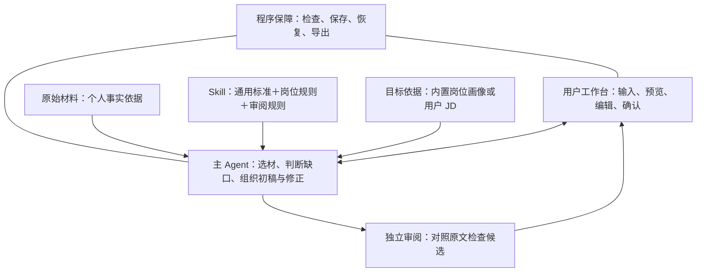

# Match-Trajectory：AI 简历助手方案

汇报简版｜2026-11-03

> **让互联网求职者用少量材料、少量交互，得到一份岗位相关、事实可信、只需局部修改的简历。**

## 一、为什么做，先解决什么

用户往往有经历，却不知道选什么、怎么写；直接使用大模型，还要自己组织材料、反复提问、检查事实和处理排版。

我们把这些步骤串成一条可完成的流程，降低准备、沟通和修改成本。**首期聚焦简历交付**，经历深挖、模拟面试和投递管理作为后续可选能力。

目标是让用户认可初稿的主要内容与结构，只需局部修改就愿意投递。“70%—80% 可用”是待验证的产品目标，不是模型打分，也不承诺获得面试。

## 二、为谁设计，怎样适配

首期面向中文互联网求职，重点覆盖**后端研发、算法、数据分析、产品经理、内容／用户运营**。其他方向先使用通用规则，不宣称已完成专项验证。

不只按专业或技术／非技术划分，而是组合三个维度：

| 维度 | 用户差异 | 对应设计 |
| --- | --- | --- |
| 目标方向 | 相近岗位通投／具体 JD 定制 | 没有 JD 用内置岗位画像；有 JD 调整选材与重点。跨方向分别组织简历 |
| 经历状态 | 初次求职／已有经验／转岗 | 分别突出真实实践、相关贡献、可迁移能力，不用学历或年限推断能力 |
| 材料状态 | 零散不足／丰富但杂乱／仅有岗位目标 | 少则保守起草，多则筛选压缩；没有个人事实时只给框架和补充入口 |

**默认不要求用户提供 JD、公司职级或完整个人档案。** 用户说不清时，系统用具体短问题辅助，不要求用户先总结自己的“核心竞争力”。

## 三、什么是一份好简历

**在真实经历内，让招聘方快速看清：为什么适合、本人做过什么、有什么值得面试展开。**

| 标准 | 简历应体现什么 |
| --- | --- |
| 适配 | 相关能力有经历支撑，重点与目标岗位一致 |
| 贡献 | 本人做了哪一步、用了什么方法、交付了什么 |
| 亮点 | 真实的问题、取舍、作品、验证或成果，而非空泛夸奖 |
| 易读且可信 | 重点靠前、表达简短；不编经历、技能、数字，不扩大个人责任 |

有结果就写结果，没有数字就写已有动作与交付；不为“充实”而补造事实。岗位要求只能指导选材，不能变成用户已经具备的能力。

## 四、整体结构：Agent 管流程，Skill 管写法

### Agent：把一次生成任务做完

采用**一个主 Agent＋独立审阅＋固定流程控制**。起草和审阅分开提供上下文，可使用同一个模型；首期不为每个岗位建立一套 Agent。

- **主 Agent：** 判断哪些材料值得写、哪些缺口需要问，再生成或修正候选。
- **独立审阅：** 直接对照原文、目标和候选检查，不依赖起草者的自我评价。
- **程序保障：** 控制步骤与调用上限，保存进度，处理取消、恢复、版本与导出。

这样既利用模型的判断能力，也能在失败时保住材料和已有结果，避免反复生成或覆盖用户修改。

### Skill：把“怎样写好”沉淀为可维护规则

采用**一份通用 Skill，按目标加载岗位规则**，不复制多套写作流程。

| 规则层 | 主要内容 |
| --- | --- |
| 通用标准 | 事实边界、相关性、个人贡献、简洁表达与质量要求 |
| 岗位差异 | 研发看模块与验证；算法看问题、方法与实验；数据看分析与结论；产品看判断与方案；运营看人群、动作与反馈 |
| 阶段规则 | 选材时判断价值，起草时组织表达，审阅时找问题，修正时保留未受影响内容 |

岗位画像回答“这个方向通常看什么”，Skill 回答“怎样用已有证据写清楚”。两者都不提供个人事实。后续扩展岗位，主要补充规则、案例和验证。

## 五、用户怎样完成闭环

以预览和直接编辑为主，对话只服务于补充信息。首次最多一轮三个问题，允许跳过；无需先进行长篇访谈。

| 遇到的问题 | 处理方式 |
| --- | --- |
| 材料不足 | 先用已知事实写；缺口提示，不强制补数字，不假装内容完整 |
| 模型失败或超时 | 保留材料与候选，明确原因；在剩余预算内继续，或手工编辑 |
| 审阅存在误判 | 用户选择原文、填写说明逐项核对；保留原报告，不能一键清空所有阻断 |
| 正文修改或仍有事实问题 | 重新核对当前版本；未处理阻断时保留草稿，不能直接正式导出 |

本期闭环是**简历从输入到文件交付**；投递、面试和录用属于后续求职流程。

## 六、设计取舍与当前进展

既有调研带来的取舍是：保留成熟简历工具的可编辑、可导出体验，借鉴岗位匹配的选材思路，把事实检查和用户确认纳入交付流程。

本项目希望验证的价值是：**没有具体 JD、材料不充分的用户，也能以较低成本完成基础简历。** 开源和自选模型便于使用与扩展；目前仍缺少成熟产品的规则积累、编辑体验和大规模效果证据，不能据设计宣称领先。

| 当前已有 | 下一步重点 |
| --- | --- |
| 文字输入、可选 JD、五方向规则、生成与审阅 | 补足各方向真实案例，验证初稿是否减少用户修改 |
| 直接编辑、逐项人工核对、PDF／Word 导出 | 优化排版、文件上传与材料复用 |
| 任务保存、取消恢复、本机便携程序 | 完善首次配置、数据管理与干净系统安装验证 |

当前为 **M1.5 开发版**：已增加持久图编排和可选受控主管修正，保留原编辑、审阅与导出；本地合成HTTP流程已验证，真实模型对照仍待完成。此前在一份材料上观察到DeepSeek完成M1生成与审阅，也暴露过误判。流程可运行不等于普遍质量达标。

## 七、下一阶段目标与资源支持

| 重点 | 怎么判断有效 | 需要的支持 |
| --- | --- | --- |
| 初稿质量 | 用户是否只需局部修改；分别看岗位方向、无 JD 和稀疏材料场景 | 五方向审阅者、授权材料与反例 |
| 使用成本 | 从首次配置到独立导出，记录时间、失败、调用费用和修改量 | 至少 20 名试用者，包含无 API 配置经验者；真实模型预算 |
| 开源交付 | 用户按说明可启动、恢复任务并导出；发布限制清楚 | 独立 Windows 测试环境、第三方许可核验、维护人力 |

下一阶段先验证“用户是否更省事地得到一份可用简历”，再决定是否扩展经历深挖、模拟面试和投递管理。GitHub 首先交付源码、规则、运行说明与已知限制；便携包完成安装和许可验证后再正式发布。

## 八、后续演进：把修改变成可复用经验

持久编排与受控修正已接入；以下偏好与经验学习仍为后续建议，让下一次少改同类问题。

| 方向 | 做法 |
| --- | --- |
| 自适应 Skill | 稳定的基础规则＋按岗位和场景生效的个人偏好、写作经验；事实纠正单独处理，不让一次编辑覆盖公共 Skill |
| 更大的闭环 | 修改差异与原因 → 偏好或方法候选 → 检查与验证 → 下次按需复用；用户可查看、撤销和关闭 |
| 受控Supervisor | 在M1业务层之上引入LangGraph，复用理解、写作与审阅；程序保留版本、预算与导出控制，固定步骤不额外调用主管模型 |

**M1.5继续验证真实模型和用户收益，M2再接可选偏好学习，之后验证经验复用与审阅拆分。** 旧任务沿用旧执行器，新模式只用于新任务，不重建用户库。采用LangGraph与受限工具委派；来源与迁移步骤见[Agent方案第9节](简历Agent架构设计方案.md#9-m15supervisor-兼容升级方案)。

重点看修改量、岗位表达、事实错误、费用和耗时；“流程跑通”和“写得更好”分别验收。学习设计见[产品方案第9节](互联网求职简历Agent产品设计方案.md#9-m1-之后让每次修改帮助下一次写作)。

---

依据：[产品方案](互联网求职简历Agent产品设计方案.md) · [Agent 方案](简历Agent架构设计方案.md) · [Skill 方案](简历Skill设计方案.md) · [当前实现与验证范围](../README.md)。本文为汇报摘要，不替代开发细节。
