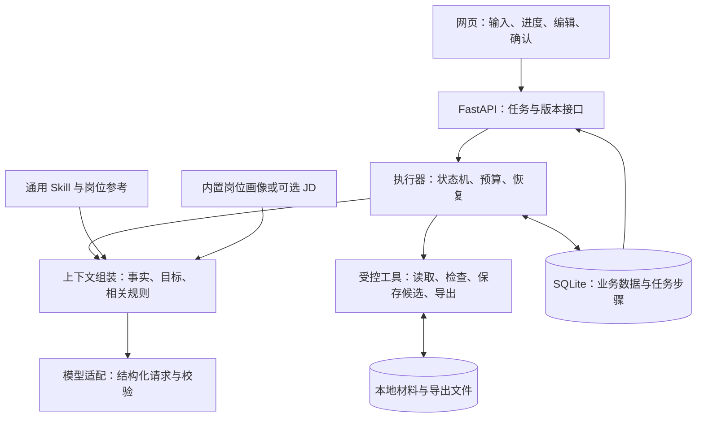
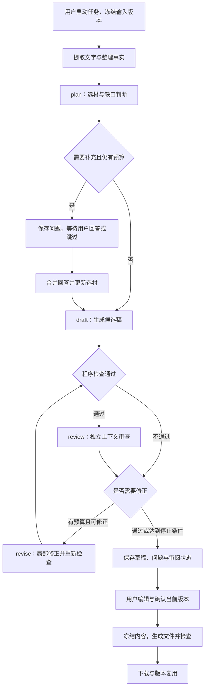
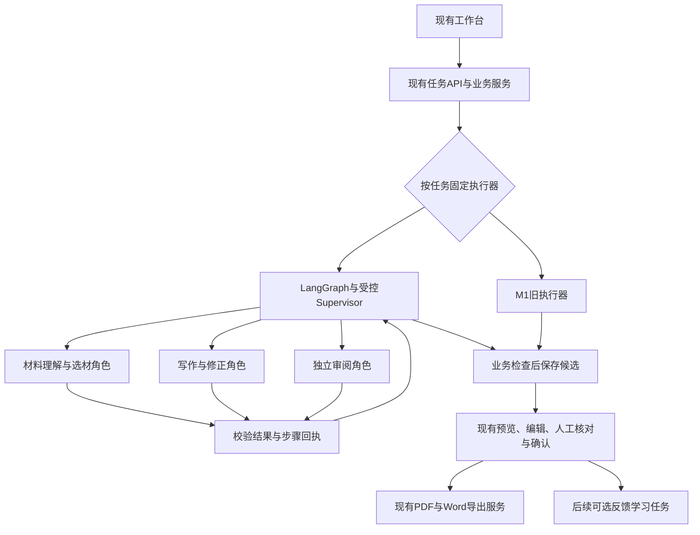
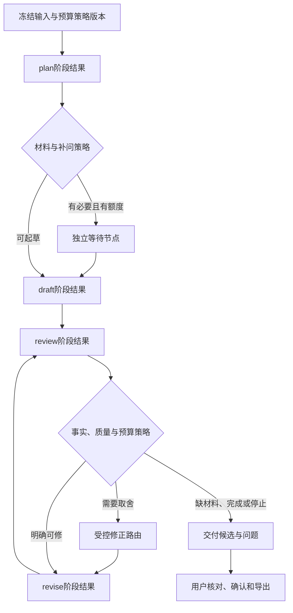

# 简历 Agent 架构设计方案

2026-11-05｜M1.6实现基线；第10节补充代码核查与后续收敛决定。已实现范围见 [README](../README.md)，后续决定不代表已开发。

相关文档：[产品方案](互联网求职简历Agent产品设计方案.md) · [Skill 方案](简历Skill设计方案.md)

## 1. 架构决定与研究依据

**首版采用：一个主 Agent＋独立上下文审阅＋显式状态机＋受控工具。** 模型负责判断，程序负责执行、保存和停止。不同阶段可复用同一模型，不为每个岗位建立 Agent。

**M1.5实现：** LangGraph持久编排＋可选受控Supervisor修正，保留业务门禁和旧执行器；具体范围见[README](../README.md)，完整迁移目标见[第9节](#9-m15supervisor-兼容升级方案)。跨任务偏好与经验学习尚未实现，仍见[产品方案第9节](互联网求职简历Agent产品设计方案.md#9-m1-之后让每次修改帮助下一次写作)。

| 方案 | 适用与代价 | 本次决定 |
| --- | --- | --- |
| 单次模型请求 | 简单、便宜，但补充、检查和恢复难展开 | 保留为效果基线 |
| 受控状态机＋主 Agent | 本任务阶段较固定；执行状态和业务版本可统一管理 | 首版采用，只实现本业务需要的状态 |
| LangGraph 编排与受控修正路由 | 提供图执行、检查点和中断；业务权限、事实与费用仍由应用保障 | M1.6已接入；路由仍在业务步骤中，第10节决定收敛方式 |
| 多 Agent 自主协作 | 适合独立并行探索；本任务更依赖同一事实源，增加交接与成本 | 暂不采用，独立审阅先用单独上下文实现 |

公开依据：Anthropic 区分固定工作流和自主 Agent，建议按收益增加复杂度；LangGraph 文档确认持久化与中断能力，恢复时仍需注意节点重放。[工作流方法](https://www.anthropic.com/research/building-effective-agents)、[LangGraph 持久化](https://docs.langchain.com/oss/python/langgraph/persistence)、[中断规则](https://docs.langchain.com/oss/python/langgraph/interrupts)

源码参考：Resume Matcher 将选材与排版检查分开，并明确处理“已经保存、后续校验失败”的情况。我们借鉴阶段结果与恢复点分离，不推断整个项目的 Agent 拓扑，也不照搬代码。[选材实现](https://github.com/srbhr/Resume-Matcher/blob/main/apps/backend/app/services/tailor_selection.py)、[保存与校验实现](https://github.com/srbhr/Resume-Matcher/blob/main/apps/backend/app/mcp_server/tools/tailor_and_verify.py)

## 2. 总体结构与职责

沿用 React／TypeScript／Vite、Python 3.12、FastAPI／Pydantic、SQLAlchemy／SQLite。后端同时提供前端静态文件；一个主服务进程、一个执行队列，每工作区同时执行一个生成或导出任务，编辑仍可继续。执行器在应用生命周期内运行，不依赖某次 HTTP 请求存活；耗时文件处理放入受限工具子进程，避免阻塞网页接口。

| 部分 | 负责什么 | 不能替代什么 |
| --- | --- | --- |
| 主 Agent | 识别目标、选材、判断缺口、组织表达和修改建议 | 不直接写库、发文件或任意运行脚本 |
| Skill | 选材、写作、岗位差异与质量规则 | 不提供个人事实，不管理任务进度 |
| 执行器 | 允许的下一步、预算、检查点、取消与重试 | 不以聊天记录推断任务是否完成 |
| 上下文组装 | 按本次任务选取事实、原文、目标和规则 | 不默认注入全部资料与历史对话 |
| 工具与业务服务 | 读写、校验、版本、渲染和下载 | 不把模型建议直接当已确认内容 |

Skill 由应用按阶段加载并注入模型，无需模型访问文件系统；仅放置 `SKILL.md` 不会自动生效。[接入规范](https://agentskills.io/client-implementation/adding-skills-support)

## 3. 执行流程与停止点

状态机限制调用次序；模型只返回允许的决策与结构化内容，不决定工具权限。无 JD 自动加载内置画像，岗位方向澄清占用同一轮问题预算。首次最多一轮三个问题，可跳过；零个人事实返回框架，不伪装成投递就绪。

程序结构检查失败时不进入语义审阅；修正后重新检查。审阅问题仍在或预算耗尽时保存可恢复草稿，不能靠标记“完成”跳过问题；若没有可解析候选稿，则保存材料与错误并将任务标为失败。草稿生成完成与正式文件可导出是两个状态。

用户只改一段时，直接进入局部修改路径，带上该段及必要上下文，不重新起草整份简历。换目标方向创建副本，复用个人事实。

## 4. 模型调用与工具边界

| 阶段 | 最小上下文 | 输出 |
| --- | --- | --- |
| 整理事实 | 选定材料、对应原文位置、用户目标 | 带来源的事实候选、冲突和未知项 |
| plan | 事实、目标画像／JD、相关规则、剩余问题数 | 选材计划，或一组补充问题 |
| draft | 已选事实及原文、表达计划、相关规则 | 有段落 ID 与事实引用的正文 |
| review | 候选稿、支撑原文、目标依据、质量规则 | 定位到段落的分级问题，不读取起草自评 |
| revise | 目标段落、允许的修改、必要事实、基准版本 | 局部补丁与引用，不覆盖整份文档 |

每次请求固定模型配置、Skill 和岗位画像版本。使用经验证的文本接口，Pydantic 校验结构；原生工具调用不是前提。输出截断、字段缺失或引用错误不得静默修补后当正常结果使用。

工具是内部函数白名单：读取本任务材料、读取内置画像、验证引用、检查正文、保存候选、生成导出件、检查导出件。当前状态决定可用工具；模型不能指定任意路径、网址、SQL 或命令。首次提交已授权生成候选，不重复逐步确认；应用最终确认与外部动作权限仍由用户掌握。

预算按整个生成任务累计：通常四次模型请求；补充整合、失败重试和修正均计入最多八次，内容修正最多两轮。结构错误最多重试一次；次数不足时以总预算为准，并为最终审阅预留请求。默认单请求超时 45 秒、累计执行上限 180 秒，等待用户不计时；恢复任务不清零预算。

配置预设包含已验证能力、输入上限和输出限制；无法精确计 token 时采用保守字符限制。材料每任务最多 20,000 字，超限先让用户选取，不能静默截断。上下文只放相关事实与原文；摘要不能代替精确数字、个人归属及论文状态。

原文与相关限制一起提供：例如“仅负责仿真、没有线上部署”不能只留下正向技能。事实抽取和审阅均对照原文，不用抽取结果自证正确。每次真实发出模型请求前持久化扣减次数；超时不返还，禁用绕过执行器计数的隐式重试。

调用记录保存模型、规则版本、请求次数、耗时、token 和错误类别；价格未知显示未知。默认日志不存正文、Key 或完整提示词；所需原文仅在工作区内按材料权限保存。

## 5. 数据、版本与任务恢复

| 数据 | 保存与使用规则 |
| --- | --- |
| 材料与事实 | 原文、来源、事实 ID、版本和用户确认状态；陈述不等于客观核实 |
| 目标依据 | 用户方向、画像版本与来源；具体 JD 另存，不能冒充个人事实 |
| 简历版本 | 正文、引用、父版本、审阅状态与用户确认；导出后内容冻结 |
| 任务与步骤 | 输入版本、当前阶段、步骤输出、错误、预算与执行记录 |
| 导出记录 | 简历快照、模板版本、文件校验值、检查结果和完成状态 |

任务状态限定为 `queued / running / waiting_input / ready / failed / interrupted / cancelled`。`ready` 只表示已交付候选结果；是否可正式导出，由正文问题、当前确认和文件检查共同决定。等待用户时保存问题后释放执行槽，不保持网络请求或执行循环；回答／跳过通过短事务消费问题组并重新排队。

**一个步骤的写入顺序：** 短事务领取步骤并登记尝试 → 事务外调用模型或工具 → 短事务校验任务有效及输入版本 → 一并保存输出和下一状态。领取时保留唯一执行标识；重复请求用客户端幂等键返回原任务，不新建付费调用。

SQLite 是任务状态的唯一来源；队列只负责唤醒执行器，不保存第二份进度。单服务实例持有工作区锁；数据库使用本地磁盘、WAL 与短事务，不放网络共享盘。SQLite 同时只允许一个写事务，不能在网络调用期间占着写锁。[事务说明](https://www.sqlite.org/lang_transaction.html)、[WAL 说明](https://www.sqlite.org/wal.html)

| 事件 | 恢复动作 |
| --- | --- |
| 页面关闭或刷新 | 查询原任务，继续显示结果；不重发生成请求 |
| 回答补充问题 | 带任务与问题组 ID；只消费一次，旧答案不能恢复新任务 |
| 进程重启 | 未完成运行标为中断；用户继续后，从最后成功步骤恢复 |
| 模型结果未保存时崩溃 | 该请求可能已计费；明确告知后由用户继续，不承诺只计费一次 |
| 取消或删除 | 立即改变状态；写回前检查执行标识和版本，丢弃迟到响应 |
| 手工编辑与 AI 同时发生 | 补丁绑定 `base_revision`；版本已变则展示差异，不覆盖新编辑 |
| 更正事实 | 相关当前段落进入复核；历史文件保留原快照并标为过时 |
| 原材料在生成途中变更 | 中断使用旧材料的任务，保留结果供查看；以新输入版本重新生成，不悄悄混用 |
| 保存成功、后续检查失败 | 保留已保存版本，只重试失败阶段，不重复创建简历 |

个人长期资料、当前任务检查点与聊天记录分开。更正事实会影响后续选材；聊天摘要和旧版本不能悄悄成为新事实。

**失效规则：** 事实修订不可变，修改产生新修订 ID；`fact_ids` 引用具体修订。审阅和用户确认绑定简历版本、事实依赖集合、目标依据与规则版本。相关事实更正或删除时，清除当前有效确认并复核关联正文、候选补丁和在途导出；即使正文没改字，也不能沿用旧通过记录。历史文件保留原快照并标为过时，不能登记为当前有效成果。

## 6. 内容确认与文件交付

**正式导出条件：** 正文没有未处理冲突或待确认扩写、程序检查通过、用户确认当前版本；AI 正文还须有针对该内容版本有效的审阅通过记录。不要求填满档案，也不因真实岗位差距阻止导出。

AI 审阅明确区分“未审阅／失败／有阻断／通过”；没有问题列表不等于通过。未审阅或失败的 AI 稿默认只能导出草稿，普通确认不能清除该状态；修改过的内容不能沿用旧审阅结果。

保留无需 AI 的手工路径：手工录入直接作为用户陈述保存；接管 AI 草稿则需用户主动选择“自行核对并转为手工版本”，确认核对当前正文。保留 AI 来源与旧报告，显示“用户自行核对，未经 AI 审阅”，不伪造审阅通过，也不强制付费。已知事实冲突或阻断仍须修正、删除，或由用户补充事实解决，不能仅切换标签消除。

若用户认为审阅误判，可定位已有原文并填写说明；问题记录区分“未解决／修改解决／依据原文人工解决”，保存来源、说明、处理人及版本。人工解除不改写 AI 原始结论；未重新 AI 审阅时，按手工核对版本导出。无依据或其他阻断仍未解决时，继续保留草稿，不能一键清空全部问题。

PDF 与网页共用打印模板，DOCX 从同一内容结构生成；默认 A4 单栏、一至两页。DOCX 可编辑，允许 Word／WPS 分页差异；PDF 文字可选取。不自动加照片、年龄、婚育等信息。

每次导出冻结版本，独立列出应出现的正文清单，核对两个格式的内容，避免渲染器漏段却仍通过自检。PDF 运行时检查正文、页数、字符与坐标溢出、链接；超页提示删减或切两页，不无限缩小字号。发布前对代表样本渲染并人工检查视觉布局。

DOCX 运行时检查 OOXML 结构、正文一致性、样式和链接，不声称逐次核实其在 Office 中的分页和裁切。发布时在目标版本 Word／WPS 人工核对排版，记录已验证版本；首版不捆绑 LibreOffice，不要求用户安装 Office 才能生成文件。

文件按“快照＋格式＋模板版本”标识，临时写入后检查，成功才发布下载记录；发布前重新核对当前确认与事实依赖。单次文件工具默认 60 秒上限，超时或主服务退出时回收工具及浏览器后代进程，保留输入供重试；不无期限占队列。崩溃临时文件可清理，已有成功文件不覆盖。数据库与文件无法一起提交时，启动后校对记录，完成登记或标为失败，不返回不存在的文件。

## 7. 部署、凭据与资料保护

| 交付形式 | 实现约定 |
| --- | --- |
| Windows 11 x64 便携包 | PyInstaller 目录包＋前端＋匹配版 Chromium＋中文字体；双击启动，无需 Python、Node、Docker 或 Office |
| Linux amd64 Docker | 同一服务与持久数据卷，主机端口只绑定回环地址 |
| 模型配置向导 | 供应商预设、默认模型、官方 Key 申请指引、合成短文本连接测试；自定义参数在高级设置 |

程序、数据和可选凭据分开存放；启动器单实例、健康检查、端口冲突换端口，并提供停止入口。浏览器二进制须随 Playwright 版本固定；冻结包、字体与原生依赖必须在干净系统验证。[PyInstaller](https://pyinstaller.org/en/stable/usage.html)、[Playwright](https://playwright.dev/python/docs/browsers)

冻结包须验证工具子进程启动、超时、主服务退出与再次导出，不能只验证源码运行。若采用 Python multiprocessing，按 PyInstaller 要求处理冻结入口，避免重复启动服务。[冻结应用进程说明](https://pyinstaller.org/en/stable/common-issues-and-pitfalls.html#multi-processing)

Key 只由本地后端调用，默认会话保存；可选持久保存时，Windows 使用系统凭据保护，Docker 主密钥单独挂载。任务仅保存配置版本与凭据引用；缺少旧凭据则重新连接，不能把 Key 自动发送到新地址。

API 校验本地会话、Origin 和 Host；文件随机 ID 存储，限制类型、大小与解压后内容，不执行上传文件。JD 和原文属于不可信资料，不能修改系统规则；渲染禁止远程资源和任意本地文件读取。

输入限制：每任务最多 5 个文件、每个 10 MB、PDF 最多 20 页；DOCX 展开总量最多 50 MB、最多 1,000 项，检查内容类型并禁止外部实体和路径越界。扫描件、加密文件与旧 DOC 明确回退到粘贴／转存文字，不偷偷当已读。

解析结果保留页／段落与表格位置，展示失败或未处理范围；不能以“抽到非空文字”认定完整。M0 对双栏 PDF、混乱文字层、表格简历和混合图文建立已知内容清单，检查漏段及日期／人物错接；不可靠时提示核对识别文本或改用文字输入，不要求所有用户先做长篇校对。

上传前告知远程模型会接收哪些材料；联系人等无关字段本地回填。无默认遥测；支持删除原件、派生文件和缓存。共享材料与历史版本存在引用时，删除先展示影响范围，再按选择清除引用及文件，不能留下有效状态的悬空引用。

备份进入短暂维护状态：暂停新任务和写入，等待在途步骤结束或中断，再用 SQLite Backup API 生成数据库快照、按清单复制文件并核对校验值；失败不发布备份包。Key 单独存放且不进入备份。不能只复制活动中的 `.db` 而遗漏 WAL 中的改动。[SQLite 备份说明](https://www.sqlite.org/backup.html)

恢复同样停止写入，校验数据库、文件清单、格式与版本；先备份现状，再整体替换。恢复的在途任务转为中断，不能自动重放付费请求；缺凭据则重新连接。升级前也做一致备份，失败保留旧程序和旧数据；用户自行复制的旧备份需自行删除。

v0.1 为单用户本地产品，不暴露无鉴权公网服务。免 Key 托管服务和本地模型均未纳入正式支持。

## 8. 先验证什么，再扩展什么

| 阶段 | 必须拿出的证据 |
| --- | --- |
| 技术探针 | 两种模型组合完成结构化调用；中文 PDF／DOCX 与 Windows 冻结包可运行 |
| 生成闭环 | 无 JD、稀疏材料、补充跳过、独立审阅、局部修正都能完成；事实不被扩写 |
| 故障验证 | 限流、超时、重启、取消、删除、重复请求、编辑冲突、磁盘满与导出失败可恢复 |
| 开源发布 | 两种供应商／模型组合通过真实材料整理、选材、生成、审阅与修改；干净系统独立安装、文件与备份恢复可用，并通过产品试用门槛 |

故障测试检查可见结果和持久状态：没有丢内容、重复保存、恢复已删资料或覆盖用户编辑。模型不可用时仍可编辑导出；不能用模拟模型通过代替真实接入验证。

M1.5 按第 9 节增量引入 LangGraph／Supervisor；业务事实、简历版本、API 与导出约定保持独立。并行队列、更多 Agent 或 MCP 仍按收益引入，不承诺可无成本迁移。

本文包含尚未实现的完整产品目标；当前开发版已通过程序与本地 HTTP 测试服务的流程验证，未完成真实模型、真实用户、压测和公开发布验证。

## 9. M1.5：Supervisor 兼容升级方案

**选择 Supervisor 分工模式，保留 M1 的业务层；替换执行编排，不替换整套产品。** 以下保留完整升级目标；A／B及受控修正已实现，C仍需真实模型对照，D学习未实现。依赖已锁定，发布仍按兼容里程碑验收，不以“1—2周”作承诺。

### 9.1 官方机制与需要纠正的假设

| 核查项 | 官方资料与本项目结论 |
| --- | --- |
| 架构与具体包 | [`langgraph-supervisor-py`](https://github.com/langchain-ai/langgraph-supervisor-py) 已于2026-09-20归档；README建议多数新项目用tool-calling直接实现Supervisor。默认方案采用该模式；旧包如需验证，放入锁版本、可替换的实验适配器，不绑定业务模型 |
| 上下文隔离 | 旧包支持选择返回完整历史或最后消息，但默认handoff会携带完整主管消息。隔离不是自动权限控制，需显式限定子Agent输入和输出。共享State也不意味着人人可改事实 |
| 检查点与重试 | 持久化要配置checkpointer；[中断恢复](https://docs.langchain.com/oss/python/langgraph/interrupts)可能从节点开头重跑。检查点不保证模型不重复计费、文件只生成一次，业务仍需幂等与执行回执 |
| 串行、层级与节点数 | [官方Subagents](https://docs.langchain.com/oss/python/langchain/multi-agent/subagents)支持并行，旧包也有多层示例；单层是本项目的取舍。业务角色数不等于编译后的图节点数，不存在已证实的“简历最多5个Agent”通则 |
| 性能结论 | [2025-06-10基准](https://www.langchain.com/blog/benchmarking-multi-agent-architectures)针对扩展τ-bench、干扰领域和工具；包含handoff精简、结果转发及工具命名试验，未证明所有简历任务都更省token或固定命名必胜 |
| AWS案例 | [2025-04-14文章](https://aws.amazon.com/blogs/machine-learning/build-multi-agent-systems-with-langgraph-and-amazon-bedrock/)给出LangGraph与Bedrock的实现案例，不能据此替本产品完成生产验收，也不要求本地用户引入AWS |

因此，本项目采用**LangGraph运行时＋明确的Supervisor／子Agent协议＋现有业务门禁**。具体库的维护状态、模型能力和打包兼容独立验证；按当前官方路线实现工具调用，不等于自行重做检查点引擎。

### 9.2 保留哪些部分，新增哪些部分

| M1已有部分 | 升级方式 |
| --- | --- |
| React工作台和任务API | 保持输入、轮询、补问、取消、采用、编辑、重审和下载操作；内部图节点映射回已有阶段与状态 |
| `GenerationService`、`JobStore` | 继续管理任务、幂等、版本、调用账本与采用；新增执行器类型和版本，禁止旧任务悄悄换引擎 |
| `ModelClient`与供应商配置 | 保留现有结构化生成／审阅能力；另做Supervisor工具调用适配和能力探针，Key不进入State或检查点 |
| 运行Skill与Schema | 原样复用岗位、阶段、示例、`Draft`和`WritingReview`；框架迁移不同时重写全部写法，便于判断变化来源 |
| `ResumeStore`、人工核对、PDF／DOCX | 沿用事实来源、审阅失效、确认门禁和文件检查；Render保留为服务／工具节点，无需再让模型“渲染” |
| 新增部分 | 执行器接口、LangGraph适配、节点输入投影、步骤回执、持久检查点；反馈学习在后续独立接入 |

图为本产品定制拓扑，不是安装旧包就自动得到的结构。每次委派前检查当前版本、允许动作和剩余预算；Supervisor不能跳过业务检查直接完成导出。

### 9.3 角色如何分工

- **Supervisor：** 决定当前需要的业务动作、解释下一步策略；只可选择允许的子任务，不能任意改写事实、循环上限和确认状态。已确定的步骤可走固定边，不为每次传递额外调用一次模型。
- **材料理解角色：** 先复用当前plan，整理目标、证据、主线与至多一轮补问。文件读取／OCR由工具服务负责；抽取结果是带原文位置的候选，不自动成为事实。
- **Writer：** 使用相关证据、Skill、有效偏好及指定修改意见，输出结构化`Draft`，保留固定教育信息、时间和稳定条目标识。
- **Review：** 读取候选、原始依据和目标，返回`WritingReview`中的事实结论与四维质量；不读取起草者自评。首期继续一次双维审阅，不因迁移增加两套重复评审。
- **Render服务：** 仅处理已冻结并确认的内容版本，直接复用当前HTML／PDF／DOCX链路。Supervisor可以返回候选引用，不能再把正文转述一遍后拿去导出。

`forward_message`可用于聊天文字透传；文件交付以已校验内容和版本为准。材料多份、事实／质量独立审阅是否并行，后续按收益决定；新增岗位优先扩展Skill，而不是新增一个Agent。

首轮仍按理解→写作→审阅推进。审阅后先由程序分类：唯一合法动作走固定边；多项可修意见需要取舍范围、优先级时，再让Supervisor选择并委派局部修正。修正后必须重新审阅，主管不能自行宣布事实通过。这是首期的决策范围，后续才按案例扩展。

### 9.4 State保存引用和版本，业务库保存权威结果

不将整份简历改成Markdown字符串，不用一个可随意覆盖的`user_profile`承载所有事实。保留当前结构化内容与证据模型。

| 状态组 | 应包含什么 | 谁可以修改 |
| --- | --- | --- |
| 任务身份 | job_id、执行器／图版本、thread_id、run_token | 程序生成并验证；一次任务固定引擎和线程 |
| 输入快照 | 原文／补问版本、目标版本、Skill版本、偏好版本 | 用户操作经业务服务提交；子Agent只读所需投影 |
| 证据与候选 | 原文引用、抽取候选、选材计划、草稿ID／版本／哈希 | 对应节点提出结构化更新，由宿主验证后写入 |
| 审阅结果 | 审阅对应的草稿哈希、事实问题、质量状态、可执行意见 | Reviewer提出；程序检查引用与结论一致性 |
| 执行信息 | 当前阶段、等待问题组、步骤回执引用 | 程序维护；预算以原业务账本为准，不能通过回退检查点清零 |

每个节点只拿需要的字段，只能提交自己负责的字段；TypedDict／Pydantic本身不是权限系统。Writer不能更新已确认事实，Reviewer不能改候选正文，所有角色都不能设置“用户已确认”。姓名与联系方式继续本地回填。

临时工作上下文默认不拼入其他角色提示词；不要求采集模型私有思维链。明确区分持久化执行记录与下一次模型输入，不能把“没有注入上下文”误当“磁盘上已删除”。

`JobStore`／`ResumeStore`继续是业务权威；LangGraph持久检查点保存执行进度与结果引用。建议检查点使用独立的本地SQLite文件，避免与业务写事务互相长时间占锁；长时记忆是另一类数据，不能用线程检查点替代。[官方持久化区分](https://docs.langchain.com/oss/python/langgraph/persistence)

### 9.5 路由依据是问题性质，不是问题总数

| 当前结果 | 下一步 |
| --- | --- |
| 结构／引用校验失败 | 对当前阶段做有限重试，附脱敏反馈，次数仍计入总预算 |
| 有原文可修的事实／表达问题 | 在剩余预算内回Writer，带定位意见与允许依据，不重写无关段落 |
| 真实材料缺口、缺少JD技能依据 | 保留`need_input`及缺口；有补问额度时可问，否则交付带提醒的候选，不从JD补技能 |
| 只有建议或已达到可接受表达 | 保存候选交给用户，不因`issues_count > 0`无限重写 |
| 事实阻断仍未解决、预算不足或模型失败 | 保存候选和原因，保留草稿／人工核对路径，不能直接正式导出 |

事实审阅通过不等于写作质量通过；写作质量通过也不能抵消事实阻断。节点返回、Supervisor决策与最终保存都要经过业务校验，不能只靠一句system prompt维持这些规则。

### 9.6 预算、恢复与用户修改

**预算：** Supervisor自己的模型请求、子Agent内部请求、工具调用后的再次推理和失败重试都计入原账本。示意：若每个子任务前后都调主管，三个子任务的一次直通可能是4次主管＋3次子任务＝7次请求，几乎用完M1的8次上限。节点少不代表调用少，也不能保证迁移后更便宜。

默认升级采用受控Supervisor模式：固定步骤用图边，策略选择才用主管模型；它是本项目的定制流程，不冒充旧包工厂的默认行为。若试验完整工具调用循环，应明确展示可用修正次数，不悄悄增加预算。Supervisor工具调用能力要用合成探针及完整链路验证，当前短文本连接通过不能代替；不支持时保留M1模式。

调主管前先为拟执行的修正和最终审阅预留调用与时间；不足时保留已有候选和原因，不能让主管耗尽预算后再留下未经审阅的新正文。

**恢复：** 每步先登记尝试，再事务外调用，校验任务令牌与版本后，原子保存结果和步骤回执；最后由图记录检查点。若业务结果已保存、检查点未保存，重跑先复用回执；若远程调用后、本地保存前崩溃，费用可能已产生，不能承诺只计费一次。业务库与检查点不具备跨库原子性，恢复时据回执校对，不把两份进度当两个权威。

等待补问使用独立interrupt节点，不在其前面夹带付费调用或文件发布；恢复仍须验证问题组、用户输入版本和原任务。回退检查点不能恢复已取消任务、旧确认或旧预算。框架重试与模型适配器重试统一接入账本，禁止多层隐式重试。

**用户修改：** 保留当前“采用候选→编辑保存→重新审阅→确认导出”的产品路径，不要求整段编辑过程都挂在一个暂停中的生成图里。每次重审仍是绑定当前简历版本的新任务；迟到结果不得覆盖新编辑。需要补问的任务才暂停等待，释放执行槽，刷新恢复状态而不重发模型请求。

反馈萃取在用户允许后成为独立任务，记录其来源版本、作用域和费用上限；默认不静默运行、不直接覆盖公共Skill。生成结束不是自动取得后台付费授权，具体沿用产品方案第9节。

### 9.7 分阶段迁移与验收

| 阶段 | 改动 | 必须保住什么 |
| --- | --- | --- |
| A：建立适配边界 | 提取统一执行器接口，原Workflow作为legacy实现；新字段可选、旧任务默认legacy | 现有API、Schema、资料、版本历史、模型配置、UI与导出不变 |
| B：先用LangGraph承接旧流程 | 将现有plan／draft／review／revise包装为节点，加入持久检查点和回执校对 | 同样的输入、失败分类、问题预算、取消与恢复语义；先通过本地HTTP测试 |
| C：引入Supervisor决策 | 在明确边界内启用工具调用子任务、上下文投影和受控路由；只给新建试验任务启用 | 模型能力探针、账本计费、循环停止及真实模型对照通过，才能扩大默认使用 |
| D：再接反馈学习 | 个人偏好／方法候选作为单独版本化数据和任务 | 权限、撤销、删除、成本和不学错事实；不阻塞原生成流程 |

旧任务继续使用创建时的引擎和图／协议版本；出错不自动换另一引擎重跑付费流程。停用新引擎只影响新任务，在途任务仍按自身版本恢复；无法恢复时保留结果并明确处理，不伪装为恢复成功。

升级采用增量表／字段与版本迁移，不重建或清空用户库；旧文件、快照和业务哈希保持可读。依赖先在现有Python3.12与锁文件中验证，按需要延迟加载新执行器；便携包同时验证新依赖、SQLite检查点及工具子进程。无需AWS、Docker或LangSmith托管才能使用，诊断日志默认不上传个人材料。

验收先重跑已有M1回归，再补：节点失败恢复、回执与检查点错位、补问恢复、重复请求、取消迟到、并发编辑、旧库与旧任务、双引擎隔离、模型不支持工具、预算耗尽和便携包。删除／备份恢复要覆盖新检查点与衍生经验，不留下可复活的旧资料。

流程兼容之后再用相同材料、模型与预算对照简历质量、修改量、费用和耗时；失败用例分别归因于理解、写作、审阅、调度或工具。Supervisor迁移本身不是写作质量提升的证据，不能只以“图能运行”宣布升级完成。

## 10. M1.6评审核查与后续收敛决定

2026-11-05，对照源码基线`b9b6064`核查。本节是下一阶段设计依据，优先于第9节中的旧实施顺序；本轮仅改文档，没有迁移执行器或修改预算。

### 10.1 核查结论

**工程闭环已有基础，模型效果仍缺证据；先验证质量，同时收敛编排，暂停扩展Agent数量。**

| 评审项 | 当前代码事实 | 结论 |
| --- | --- | --- |
| 双执行器、图包装 | `execution.run_graph`各阶段调用同一`Workflow.execute_step`；步骤内部改业务stage，图再读取stage路由 | 成立。是迁移脚手架，图尚未完整表达业务流程；固定退场条件，不能长期双轨 |
| 检查点收益与风险 | 已提供持久化和补问中断；业务提交领先检查点时按stage/revisions校对 | 不是没有收益，但并非通用步骤级幂等协议；回执不能被夸大为跨库原子性或零重复计费 |
| Supervisor名实 | 原生工具返回修正计划，宿主再调用Writer；Writer/Review已有各自阶段规则与独立HTTP请求上下文 | 定义为“受控修正路由”。不宣称完整自主多Agent协作；“完全没有独立写作上下文”“将来必然重写”也不准确 |
| 单执行槽 | 生成、导出和工具探针共用锁，长生成影响导出 | 接受单用户本地边界，记录等待耗时；多用户不在当前支持范围，扩展前必须重设计调度 |
| Job整体JSON | 每次修改重写JSON；`list`解析全表再取50条；`claim_next`用SQL筛queued并排序，只解析取出的任务 | 存储与查询成本问题成立；“两个接口都在Python解析全表”和“200条就是硬上限”缺乏依据，需测量 |
| 预算与依赖 | 多处硬编码；前端声明的状态/表单库未使用，无组件单测 | 集中策略与预算快照；按实际需要采用或移除依赖，不为用库而引入复杂度 |
| Skill重复 | 每阶段都带base；当前算法校招规则文本约5064/6206/5811/7089字符，非token数 | 有压缩空间，但独立请求必须各带必要规则；不能只发一次并假定后续模型记得 |
| 数字误报 | 合成探针中“2024年→2024”通过，“2024 年→2024”被判unsupported | 误报真实存在，但不能概括成所有年份转换都失败。先补等价表达案例，不放宽为全文任意数字匹配 |
| 时区、排队恢复、临时文件 | 上下文用UTC日期；queued/running重启均中断；启动未清理孤儿导出tmp | 均列入后续修正；queued不一定从未调用，补问后排队或失败后重排也会带历史预算 |
| 可信度与验证 | 编辑使报告失效、人工核对、删除兜底已实现；完整个人事实修订库、跨材料失效仍在待办 | 区分当前能力和目标。174项测试与合成HTTP流程不证明语义防幻觉或80%可用 |

结构错误现为**每个阶段/修正轮次最多两次失败输出，即初次＋一次重试**；恢复不清零已用请求。调用数限制不等于费用上限。

### 10.2 编排收敛：保留图，让职责归位

决定保留LangGraph，先兑现已选择的持久图与人工中断收益；不同时删除框架、改写规则和切换模型。删除LangGraph作为备选，仅在同业务契约对照下证明图的维护/打包成本不值得时另立迁移决定。

| 层 | 收敛后的职责 |
| --- | --- |
| 阶段处理器 | plan/draft/review/revise分别组装上下文、调用模型、返回结构化结果；不决定下一阶段，不随意写全局状态 |
| 图与纯路由策略 | 图显式表达阶段关系；纯策略按事实问题、写作动作、补问及预算给出允许转移，不让两个地方各写一套规则 |
| 业务提交服务 | 校验版本、令牌、引用与允许转移，原子保存阶段结果、下一状态及完成回执；可拒绝非法转移，但不另做模型调度 |
| 恢复适配器 | 检查点仅存引用；以业务回执协调恢复，不能通过回退检查点恢复已删任务或预算 |
| 兼容入口 | 旧任务绑定旧协议；不再作为新功能默认路径，符合条件后只保留只读历史 |

图是目标结构，不是当前实现截图。各节点结果经同一业务提交服务落库；不能把“纯步骤”理解成先让图向前走、以后再异步保存业务结果。

**恢复契约：** 步骤身份包含任务、图/契约版本、阶段、内容修订、输入/候选哈希及尝试编号。请求前登记尝试并预占预算；输出校验后原子保存结果、回执和允许的下一状态，再保存检查点。已提交的步骤只复用结果；远端调用完成但本地未提交的窗口标记为结果未知，由用户明确继续，不能承诺恰好计费一次。

**旧执行器退场条件：** 新图通过相同输入与预算的等价回归，以及跨阶段崩溃、补问、取消、删除、编辑冲突和导出验证；旧在途任务完成，或由用户明确终止/按已验证方案迁移。退出旧运行入口不删除历史数据；不能只因发布了新版本就移除恢复能力，也不能以仍存在旧归档任务为由永久维持双轨。

对外使用“分阶段生成＋独立审阅＋可选受控修正路由”。后续若确需多Agent，先定义任务委派、上下文、工具权限和结果契约；沿现有阶段处理器增量接入，并分别验证收益，不先承诺handoff或并行审阅。

### 10.3 预算、上下文与事实检查

- **统一预算策略：** 集中管理调用、内容修正、结构失败、单次/总耗时、审阅预留、输入/响应大小；保留单位，区分字符、字节、token、次数与金额。任务冻结策略版本，UI展示实际规则，不继续各处写死8/2/180秒。
- **费用分层：** 调用与时间继续硬限制；记录供应商返回的实际usage，发送前估算输入与输出上限并预占。按版本化供应商价格估算费用；未知价格、缓存或思考token口径不明确时显示未知，不把估算当账单，也不承诺硬金额上限。
- **按阶段最小上下文：** 每次保留必要事实边界、引用和输出约定；选材给追问规则，写作给表达/岗位案例，审阅给原文与标准。先删无关重复，不删除否定、责任、论文状态、日期或数字口径；审阅不依赖写作者自评。
- **超限有交互：** 请求前估算完整提示的长度/预算，展示超限来源；用户选择保留的经历和原文片段，生成新的输入快照，再开始或新建任务。不得静默截断，也不能只靠20000字校验拒绝用户；不得改写已在执行的冻结材料。
- **事实检查守住证据范围：** 数字、日期、单位先在同一引用范围规范化，保留数量类型和上下文；不能用其他项目的同一个数字证明本段成果。技术词表是提示手段，不是技能真实性证明。确定冲突可阻断，表达差异不直接等同造假，歧义进入可解释核对。

### 10.4 效果验证是发布门槛

先建立可复现基线，再决定改哪条规则。建议首批40个经授权、脱敏的案例，覆盖五方向、求职阶段、有/无JD及完整/稀疏材料；不是全组合覆盖，不足场景补反例。正反例、开发集、独立保留集分开，保留集不进入Skill。

对照采用相同输入与模型：A当前流程、B启用修正路由、C后续最小规则/新图。先只改一个变量；比较同预算效果，再单列为额外费用获得的收益。基线与B对照不应等待架构重构结束；真实调用显式开启、设置总预算，失败也计入记录。

记录版本、材料来源、模型参数、费用/usage、耗时、修正次数和失败原因。质量分别看：

1. 无依据新增、责任扩大、状态改变、跨项目归属等**语义级错误**；中文数量与定性夸大也要覆盖。
2. 适配、本人贡献、证据和易读性；缺材料与写得不好分开。
3. 人工审阅误报/漏报、误报解除成本、核心段落重写量和用户完成时间。

正则/引用校验与模型审阅分别归因，不能用系统自己的通过判定当正确答案。由相关岗位审阅者独立盲评并处理分歧；没有明确标注口径和分母，不报告“幻觉拦截率”。真实供应商记录目前只支持有限个案，尚未支持总体可用率结论。

建议发布门槛：保留集中不得有未解释的严重新增事实错误；报告各方向样本、误报和未通过案例，用户试用证明主要内容只需局部修改。40例无错误仍不等于零风险，不能据此宣传80%可用。没有验证完的工具调用/供应商组合保持试用标签。

### 10.5 下一阶段顺序与验收

| 顺序 | 工作 | 交付/验收依据 |
| --- | --- | --- |
| A：P0 | 统一预算策略、修时区与等价表达误报、建立真实模型基线 | 策略快照；边界无回退；相同材料真实模型对照及人工标注，不能由合成HTTP替代 |
| B：P0 | 让图承载路由，阶段处理器独立，旧入口有退场条件 | 等价与故障回归；已提交步骤不重发；费用未知窗口可解释；兼容旧材料/候选/确认/删除 |
| C：P1 | 上传可复制文字的PDF/DOCX及识别预览 | 文件类型/大小/解析量限制、页段来源、缺失提示；乱码/扫描件/复杂布局回退粘贴，不假称已完整读懂；OCR后续单独验收 |
| D：P1 | 前端按编辑、任务、核对、删除拆组件/hooks | 保留浏览器回归；加确认取消、迟到响应、版本冲突与缓存失效的状态/组件测试。按需要用现有库，否则删依赖，不强制同时引入zustand/react-query |
| E：P2 | 优化列表/排队查询、排队恢复和导出清理 | 增加状态/排序索引及SQL过滤、分页/limit；先测任务数量与载荷增长。JSON保留冻结快照，按实际成本再拆阶段结果/调用账本 |

阶段A可与编排重构准备并行；真实效果证据优先于增加Agent，上传原文预览优先于偏好学习。测试命令和通过数量按实际迭代记录，本次文档更新不构成这些能力已完成的证据。

恢复queued时区分：从未发出请求、配置仍有效的任务可按冻结授权排队；补问后重排、失败后重排、凭据失效或存在未知调用的任务先核对原配置与账本，不自动恢复付费。两类都不能清零旧预算或改变引擎。

启动清理孤儿tmp须在工作区独占、执行器启动前完成，仅处理受管导出目录下能证明归属的临时件；校验根目录与链接边界。先引入临时文件命名/登记协议，发布文件缺清单另行校对，不能递归清空所有tmp或误删已成功下载项。

核查入口：[执行适配器](../app/execution.py)、[阶段与预算](../app/workflow.py)、[任务存储](../app/jobs.py)、[受控修正](../app/supervisor.py)、[规则加载与启发式校验](../app/skill.py)、[导出](../app/exports.py)、[当前验证范围](../README.md)。
