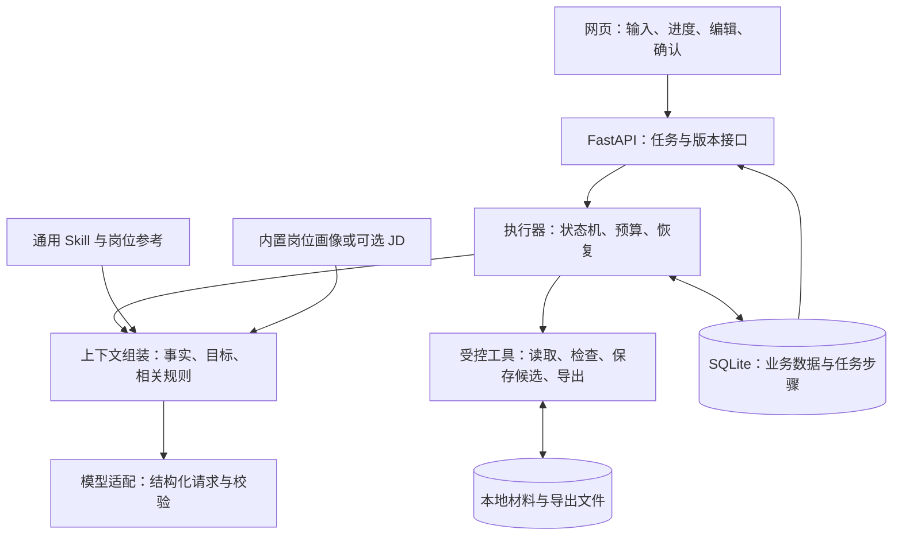
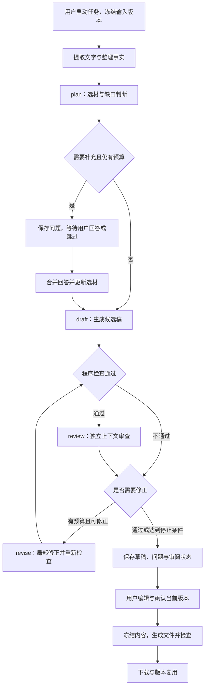

# 简历 Agent 架构设计方案

2026-11-02｜开发前复核版，业务代码与运行验证尚未完成

相关文档：[产品方案](互联网求职简历Agent产品设计方案.md) · [Skill 方案](简历Skill设计方案.md)

## 1. 架构决定与研究依据

**首版采用：一个主 Agent＋独立上下文审阅＋显式状态机＋受控工具。** 模型负责判断，程序负责执行、保存和停止。不同阶段可复用同一模型，不为每个岗位建立 Agent。

| 方案 | 适用与代价 | 本次决定 |
| --- | --- | --- |
| 单次模型请求 | 简单、便宜，但补充、检查和恢复难展开 | 保留为效果基线 |
| 受控状态机＋主 Agent | 本任务阶段较固定；执行状态和业务版本可统一管理 | 首版采用，只实现本业务需要的状态 |
| LangGraph 编排 | 已提供检查点与中断；仍需处理业务版本、重复执行和文件副作用 | 分支或长期任务显著增加时再评估，暂不引入 |
| 多 Agent 自主协作 | 适合独立并行探索；本任务更依赖同一事实源，增加交接与成本 | 暂不采用，独立审阅先用单独上下文实现 |

公开依据：Anthropic 区分固定工作流和自主 Agent，建议按收益增加复杂度；LangGraph 文档确认持久化与中断能力，恢复时仍需注意节点重放。[工作流方法](https://www.anthropic.com/research/building-effective-agents)、[LangGraph 持久化](https://docs.langchain.com/oss/python/langgraph/persistence)、[中断规则](https://docs.langchain.com/oss/python/langgraph/interrupts)

源码参考：Resume Matcher 将选材与排版检查分开，并明确处理“已经保存、后续校验失败”的情况。我们借鉴阶段结果与恢复点分离，不推断整个项目的 Agent 拓扑，也不照搬代码。[选材实现](https://github.com/srbhr/Resume-Matcher/blob/main/apps/backend/app/services/tailor_selection.py)、[保存与校验实现](https://github.com/srbhr/Resume-Matcher/blob/main/apps/backend/app/mcp_server/tools/tailor_and_verify.py)

## 2. 总体结构与职责

沿用 React／TypeScript／Vite、Python 3.12、FastAPI／Pydantic、SQLAlchemy／SQLite。后端同时提供前端静态文件；一个主服务进程、一个执行队列，每工作区同时执行一个生成或导出任务，编辑仍可继续。执行器在应用生命周期内运行，不依赖某次 HTTP 请求存活；耗时文件处理放入受限工具子进程，避免阻塞网页接口。

| 部分 | 负责什么 | 不能替代什么 |
| --- | --- | --- |
| 主 Agent | 识别目标、选材、判断缺口、组织表达和修改建议 | 不直接写库、发文件或任意运行脚本 |
| Skill | 选材、写作、岗位差异与质量规则 | 不提供个人事实，不管理任务进度 |
| 执行器 | 允许的下一步、预算、检查点、取消与重试 | 不以聊天记录推断任务是否完成 |
| 上下文组装 | 按本次任务选取事实、原文、目标和规则 | 不默认注入全部资料与历史对话 |
| 工具与业务服务 | 读写、校验、版本、渲染和下载 | 不把模型建议直接当已确认内容 |

Skill 由应用按阶段加载并注入模型，无需模型访问文件系统；仅放置 `SKILL.md` 不会自动生效。[接入规范](https://agentskills.io/client-implementation/adding-skills-support)

## 3. 执行流程与停止点

状态机限制调用次序；模型只返回允许的决策与结构化内容，不决定工具权限。无 JD 自动加载内置画像，岗位方向澄清占用同一轮问题预算。首次最多一轮三个问题，可跳过；零个人事实返回框架，不伪装成投递就绪。

程序结构检查失败时不进入语义审阅；修正后重新检查。审阅问题仍在或预算耗尽时保存可恢复草稿，不能靠标记“完成”跳过问题；若没有可解析候选稿，则保存材料与错误并将任务标为失败。草稿生成完成与正式文件可导出是两个状态。

用户只改一段时，直接进入局部修改路径，带上该段及必要上下文，不重新起草整份简历。换目标方向创建副本，复用个人事实。

## 4. 模型调用与工具边界

| 阶段 | 最小上下文 | 输出 |
| --- | --- | --- |
| 整理事实 | 选定材料、对应原文位置、用户目标 | 带来源的事实候选、冲突和未知项 |
| plan | 事实、目标画像／JD、相关规则、剩余问题数 | 选材计划，或一组补充问题 |
| draft | 已选事实及原文、表达计划、相关规则 | 有段落 ID 与事实引用的正文 |
| review | 候选稿、支撑原文、目标依据、质量规则 | 定位到段落的分级问题，不读取起草自评 |
| revise | 目标段落、允许的修改、必要事实、基准版本 | 局部补丁与引用，不覆盖整份文档 |

每次请求固定模型配置、Skill 和岗位画像版本。使用经验证的文本接口，Pydantic 校验结构；原生工具调用不是前提。输出截断、字段缺失或引用错误不得静默修补后当正常结果使用。

工具是内部函数白名单：读取本任务材料、读取内置画像、验证引用、检查正文、保存候选、生成导出件、检查导出件。当前状态决定可用工具；模型不能指定任意路径、网址、SQL 或命令。首次提交已授权生成候选，不重复逐步确认；应用最终确认与外部动作权限仍由用户掌握。

预算按整个生成任务累计：通常四次模型请求；补充整合、失败重试和修正均计入最多八次，内容修正最多两轮。结构错误最多重试一次；次数不足时以总预算为准，并为最终审阅预留请求。默认单请求超时 45 秒、累计执行上限 180 秒，等待用户不计时；恢复任务不清零预算。

配置预设包含已验证能力、输入上限和输出限制；无法精确计 token 时采用保守字符限制。材料每任务最多 20,000 字，超限先让用户选取，不能静默截断。上下文只放相关事实与原文；摘要不能代替精确数字、个人归属及论文状态。

原文与相关限制一起提供：例如“仅负责仿真、没有线上部署”不能只留下正向技能。事实抽取和审阅均对照原文，不用抽取结果自证正确。每次真实发出模型请求前持久化扣减次数；超时不返还，禁用绕过执行器计数的隐式重试。

调用记录保存模型、规则版本、请求次数、耗时、token 和错误类别；价格未知显示未知。默认日志不存正文、Key 或完整提示词；所需原文仅在工作区内按材料权限保存。

## 5. 数据、版本与任务恢复

| 数据 | 保存与使用规则 |
| --- | --- |
| 材料与事实 | 原文、来源、事实 ID、版本和用户确认状态；陈述不等于客观核实 |
| 目标依据 | 用户方向、画像版本与来源；具体 JD 另存，不能冒充个人事实 |
| 简历版本 | 正文、引用、父版本、审阅状态与用户确认；导出后内容冻结 |
| 任务与步骤 | 输入版本、当前阶段、步骤输出、错误、预算与执行记录 |
| 导出记录 | 简历快照、模板版本、文件校验值、检查结果和完成状态 |

任务状态限定为 `queued / running / waiting_input / ready / failed / interrupted / cancelled`。`ready` 只表示已交付候选结果；是否可正式导出，由正文问题、当前确认和文件检查共同决定。等待用户时保存问题后释放执行槽，不保持网络请求或执行循环；回答／跳过通过短事务消费问题组并重新排队。

**一个步骤的写入顺序：** 短事务领取步骤并登记尝试 → 事务外调用模型或工具 → 短事务校验任务有效及输入版本 → 一并保存输出和下一状态。领取时保留唯一执行标识；重复请求用客户端幂等键返回原任务，不新建付费调用。

SQLite 是任务状态的唯一来源；队列只负责唤醒执行器，不保存第二份进度。单服务实例持有工作区锁；数据库使用本地磁盘、WAL 与短事务，不放网络共享盘。SQLite 同时只允许一个写事务，不能在网络调用期间占着写锁。[事务说明](https://www.sqlite.org/lang_transaction.html)、[WAL 说明](https://www.sqlite.org/wal.html)

| 事件 | 恢复动作 |
| --- | --- |
| 页面关闭或刷新 | 查询原任务，继续显示结果；不重发生成请求 |
| 回答补充问题 | 带任务与问题组 ID；只消费一次，旧答案不能恢复新任务 |
| 进程重启 | 未完成运行标为中断；用户继续后，从最后成功步骤恢复 |
| 模型结果未保存时崩溃 | 该请求可能已计费；明确告知后由用户继续，不承诺只计费一次 |
| 取消或删除 | 立即改变状态；写回前检查执行标识和版本，丢弃迟到响应 |
| 手工编辑与 AI 同时发生 | 补丁绑定 `base_revision`；版本已变则展示差异，不覆盖新编辑 |
| 更正事实 | 相关当前段落进入复核；历史文件保留原快照并标为过时 |
| 原材料在生成途中变更 | 中断使用旧材料的任务，保留结果供查看；以新输入版本重新生成，不悄悄混用 |
| 保存成功、后续检查失败 | 保留已保存版本，只重试失败阶段，不重复创建简历 |

个人长期资料、当前任务检查点与聊天记录分开。更正事实会影响后续选材；聊天摘要和旧版本不能悄悄成为新事实。

**失效规则：** 事实修订不可变，修改产生新修订 ID；`fact_ids` 引用具体修订。审阅和用户确认绑定简历版本、事实依赖集合、目标依据与规则版本。相关事实更正或删除时，清除当前有效确认并复核关联正文、候选补丁和在途导出；即使正文没改字，也不能沿用旧通过记录。历史文件保留原快照并标为过时，不能登记为当前有效成果。

## 6. 内容确认与文件交付

**正式导出条件：** 正文没有未处理冲突或待确认扩写、程序检查通过、用户确认当前版本；AI 正文还须有针对该内容版本有效的审阅通过记录。不要求填满档案，也不因真实岗位差距阻止导出。

AI 审阅明确区分“未审阅／失败／有阻断／通过”；没有问题列表不等于通过。未审阅或失败的 AI 稿默认只能导出草稿，普通确认不能清除该状态；修改过的内容不能沿用旧审阅结果。

保留无需 AI 的手工路径：手工录入直接作为用户陈述保存；接管 AI 草稿则需用户主动选择“自行核对并转为手工版本”，确认核对当前正文。保留 AI 来源与旧报告，显示“用户自行核对，未经 AI 审阅”，不伪造审阅通过，也不强制付费。已知事实冲突或阻断仍须修正、删除，或由用户补充事实解决，不能仅切换标签消除。

若用户认为审阅误判，可定位已有原文并填写说明；问题记录区分“未解决／修改解决／依据原文人工解决”，保存来源、说明、处理人及版本。人工解除不改写 AI 原始结论；未重新 AI 审阅时，按手工核对版本导出。无依据或其他阻断仍未解决时，继续保留草稿，不能一键清空全部问题。

PDF 与网页共用打印模板，DOCX 从同一内容结构生成；默认 A4 单栏、一至两页。DOCX 可编辑，允许 Word／WPS 分页差异；PDF 文字可选取。不自动加照片、年龄、婚育等信息。

每次导出冻结版本，独立列出应出现的正文清单，核对两个格式的内容，避免渲染器漏段却仍通过自检。PDF 运行时检查正文、页数、字符与坐标溢出、链接；超页提示删减或切两页，不无限缩小字号。发布前对代表样本渲染并人工检查视觉布局。

DOCX 运行时检查 OOXML 结构、正文一致性、样式和链接，不声称逐次核实其在 Office 中的分页和裁切。发布时在目标版本 Word／WPS 人工核对排版，记录已验证版本；首版不捆绑 LibreOffice，不要求用户安装 Office 才能生成文件。

文件按“快照＋格式＋模板版本”标识，临时写入后检查，成功才发布下载记录；发布前重新核对当前确认与事实依赖。单次文件工具默认 60 秒上限，超时或主服务退出时回收工具及浏览器后代进程，保留输入供重试；不无期限占队列。崩溃临时文件可清理，已有成功文件不覆盖。数据库与文件无法一起提交时，启动后校对记录，完成登记或标为失败，不返回不存在的文件。

## 7. 部署、凭据与资料保护

| 交付形式 | 实现约定 |
| --- | --- |
| Windows 11 x64 便携包 | PyInstaller 目录包＋前端＋匹配版 Chromium＋中文字体；双击启动，无需 Python、Node、Docker 或 Office |
| Linux amd64 Docker | 同一服务与持久数据卷，主机端口只绑定回环地址 |
| 模型配置向导 | 供应商预设、默认模型、官方 Key 申请指引、合成短文本连接测试；自定义参数在高级设置 |

程序、数据和可选凭据分开存放；启动器单实例、健康检查、端口冲突换端口，并提供停止入口。浏览器二进制须随 Playwright 版本固定；冻结包、字体与原生依赖必须在干净系统验证。[PyInstaller](https://pyinstaller.org/en/stable/usage.html)、[Playwright](https://playwright.dev/python/docs/browsers)

冻结包须验证工具子进程启动、超时、主服务退出与再次导出，不能只验证源码运行。若采用 Python multiprocessing，按 PyInstaller 要求处理冻结入口，避免重复启动服务。[冻结应用进程说明](https://pyinstaller.org/en/stable/common-issues-and-pitfalls.html#multi-processing)

Key 只由本地后端调用，默认会话保存；可选持久保存时，Windows 使用系统凭据保护，Docker 主密钥单独挂载。任务仅保存配置版本与凭据引用；缺少旧凭据则重新连接，不能把 Key 自动发送到新地址。

API 校验本地会话、Origin 和 Host；文件随机 ID 存储，限制类型、大小与解压后内容，不执行上传文件。JD 和原文属于不可信资料，不能修改系统规则；渲染禁止远程资源和任意本地文件读取。

输入限制：每任务最多 5 个文件、每个 10 MB、PDF 最多 20 页；DOCX 展开总量最多 50 MB、最多 1,000 项，检查内容类型并禁止外部实体和路径越界。扫描件、加密文件与旧 DOC 明确回退到粘贴／转存文字，不偷偷当已读。

解析结果保留页／段落与表格位置，展示失败或未处理范围；不能以“抽到非空文字”认定完整。M0 对双栏 PDF、混乱文字层、表格简历和混合图文建立已知内容清单，检查漏段及日期／人物错接；不可靠时提示核对识别文本或改用文字输入，不要求所有用户先做长篇校对。

上传前告知远程模型会接收哪些材料；联系人等无关字段本地回填。无默认遥测；支持删除原件、派生文件和缓存。共享材料与历史版本存在引用时，删除先展示影响范围，再按选择清除引用及文件，不能留下有效状态的悬空引用。

备份进入短暂维护状态：暂停新任务和写入，等待在途步骤结束或中断，再用 SQLite Backup API 生成数据库快照、按清单复制文件并核对校验值；失败不发布备份包。Key 单独存放且不进入备份。不能只复制活动中的 `.db` 而遗漏 WAL 中的改动。[SQLite 备份说明](https://www.sqlite.org/backup.html)

恢复同样停止写入，校验数据库、文件清单、格式与版本；先备份现状，再整体替换。恢复的在途任务转为中断，不能自动重放付费请求；缺凭据则重新连接。升级前也做一致备份，失败保留旧程序和旧数据；用户自行复制的旧备份需自行删除。

v0.1 为单用户本地产品，不暴露无鉴权公网服务。免 Key 托管服务和本地模型均未纳入正式支持。

## 8. 先验证什么，再扩展什么

| 阶段 | 必须拿出的证据 |
| --- | --- |
| 技术探针 | 两种模型组合完成结构化调用；中文 PDF／DOCX 与 Windows 冻结包可运行 |
| 生成闭环 | 无 JD、稀疏材料、补充跳过、独立审阅、局部修正都能完成；事实不被扩写 |
| 故障验证 | 限流、超时、重启、取消、删除、重复请求、编辑冲突、磁盘满与导出失败可恢复 |
| 开源发布 | 两种供应商／模型组合通过真实材料整理、选材、生成、审阅与修改；干净系统独立安装、文件与备份恢复可用，并通过产品试用门槛 |

故障测试检查可见结果和持久状态：没有丢内容、重复保存、恢复已删资料或覆盖用户编辑。模型不可用时仍可编辑导出；不能用模拟模型通过代替真实接入验证。

M0 若发现自建执行器难以可靠通过暂停、重放和恢复测试，评估用 LangGraph 替换执行器；业务事实、简历版本、API 与导出约定保持独立。增加并行研究或长期任务时，再用实测决定是否引入队列服务、多 Agent 或 MCP，不承诺可无成本迁移。

本轮完成公开资料与部分源码核查及架构设计；未实现业务代码、未压测、未完成真实模型和用户验证。
